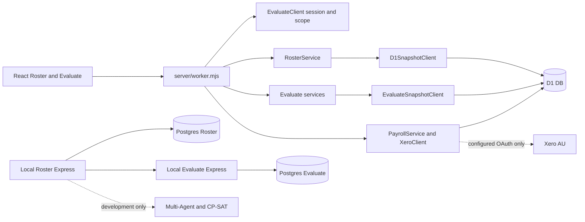

# 实际架构与业务边界

以下路径以交接根目录为准。生产源码位于 `production-site`，本地 PostgreSQL 源码只在 development 的 `local` 下。

`server/worker.mjs` 挂载 Roster `/api`、Evaluate `/api/evaluate`、Payroll `/api/payroll`、模拟员工 `/api/employee-demo`。两套 Vite UI 在 `/` 与 `/evaluate/`。`build/build.mjs` 分别构建 UI，并通过 esbuild 把 Express、Prisma、Node crypto 等替换为 Worker 适配器；`server/router.mjs` 是路由兼容层，不是在 Cloudflare 启动 Node Express 服务器。

Evaluate 是员工主数据、员工 home store、正式岗位、当前技能、评价轮次及有效 CLOSED 分数/Tier 的权威来源；Roster 不维护另一个正式员工主表。`generated/evaluate/rosterIntegrationService.ts` 输出 workforce，`server/evaluate-db.mjs` 在修改成功时原子更新 D1 中的归档与投影。Roster 班次保留员工和岗位快照，以便历史名称/岗位不随当前资料无意改变。

Roster 数据在关系表中；Evaluate 实体在 `sites_evaluate_archive(source_table,record_key,body)` JSON 行中，依靠模型适配器和 SQL 索引/触发器实现约束。`sites_source` 保存 workforce 投影；`sites_accounts` 是账号鉴权缓存。`sites_epoch` 与 `sites_guards` 用于并发乐观检查；D1 batch 在检查、实体变更、投影和版本写入间保持原子性。此方案不是完整 Prisma SQL 引擎，新增查询必须补兼容层测试。

排班流程：选择门店/周期 → 以 Evaluate 员工与正式岗位/技能校验资格 → 报班 Availability（UNKNOWN 不等于可上班）→ 手动新增/调整 → 基于版本提交草稿 → 确认后发布 → 保存只读发布快照 → 查询历史/导出。`generated/vendor/rosterService.ts` 实现周期、乐观版本、冲突和发布；`generated/vendor/routes.ts` 执行鉴权和 DTO 校验。服务端验证是最终边界，UI 可见性不是权限保障。

Availability AA/BB/CC 等是门店配置的报班时间码，应保留配置语义；模拟员工容量提示与正式员工报班需要分开。前端日历、导出、员工等分别在 `frontend/src/pages`；API Client 在 `frontend/src/lib/apiClient.ts` 与 `frontend/src/services`。

本地引擎：`local/roster/scheduling-engine/engine/solver.py` 使用 OR-Tools CP-SAT；`engine/validation.py` 是确定性验证器。候选生成、时间段人数覆盖、Full 早晚覆盖、Availability、岗位技能、休息、跨夜与孤立一小时限制由实际规则配置/模型约束决定。`multi-agent-engine` 编排规则解释与 draft-only 方案，并不替代 CP-SAT。`scheduling-engine/configs` 与其 API/Lab 是开发实验工具，不能推定为 Sites 已上线功能。

Sites 的 `generated/vendor/multiAgentRoutes.ts` 明确返回 503，health 的 `automaticScheduling=false`。本次没有部署外接求解器。排班通知/员工确认没有核实为正式员工身份下的生产闭环，不能凭日历和发布功能宣称已实现。
