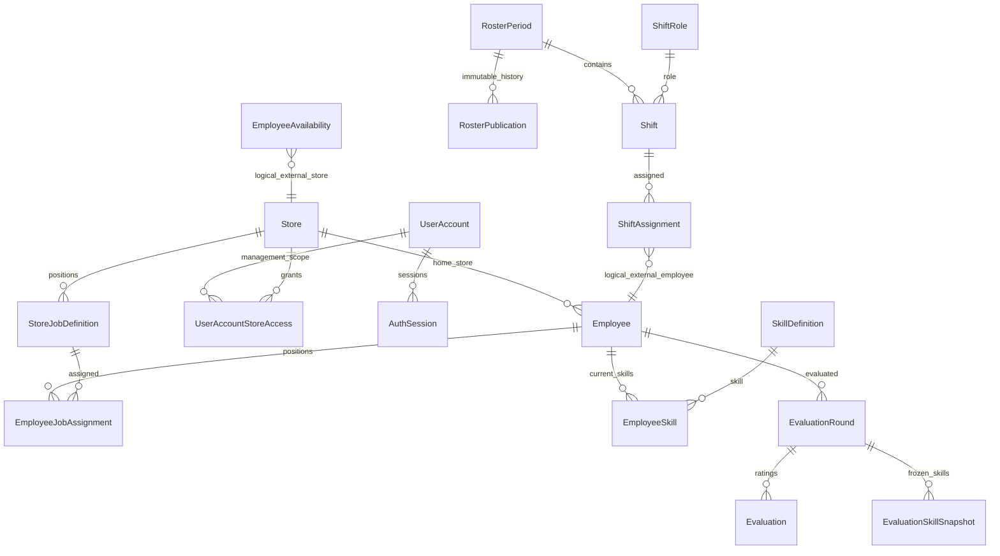

# 数据库设计与关系

全字段、Prisma 类型、nullable、defaults、unique、FK relation 和 index 见 [MODEL_CATALOG](../database/schema/MODEL_CATALOG.md)（保留完整 model 定义）；实际关系表 DDL 与迁移见 MIGRATION_INDEX。线上 D1 只读 overview 取得 25 张表，见 PROVENANCE.json 的 database.tables。没有导出真实数据库数据。

图中跨 Evaluate/Roster 的 Store/Employee 连线是**逻辑外部引用**，不是跨数据库 FK。Prisma 完整模型和迁移决定物理约束。Roster 没有本地 Employee 主表；ShiftAssignment 的 employeeId 来自 Evaluate，并带员工/分数/岗位快照。

RosterPeriod 记录 storeId、startDate/endDate/cycleType/status/version 等，Shift 记录周期、日期、startAt/endAt、breakMinutes、岗位、版本，ShiftAssignment 关联员工快照。RosterPublication 保存发布的不可变 JSON 快照、范围/版本/发布者；重复发布与 stale version 由事务/约束处理。Availability 每员工/门店/日期/时间段及版本；模板/脚本导入账本独立。员工转店不重写历史发布快照。

Postgres 原迁移包含门店-周期一致性、周期重叠限制、幂等创建 ledger 等 SQL 约束。D1 不能直接运行 PostgreSQL enum/JSONB/timestamptz/exclusion constraint，所以 `build/prepare.mjs` 生成 SQLite 兼容列和 metadata，`snapshot-db.mjs` 提供 request-scoped 类型转换、关系投影与原子提交。Evaluate 没有拆成 25+ 普通表，而是 archive JSON + 0002 的索引/shape/FK/历史保护触发器。

日期只值与真实时间点要分开：日期列按 YYYY-MM-DD；timestamp 瞬时值按 ISO/UTC 保存；Australia/Sydney/Melbourne 的显示/跨夜/DST 由 Luxon / Python zoneinfo 处理，不把 UTC 日期直接当门店营业日。Payroll 先按整数分钟计算，扣原 breakMinutes，再分摊日界/Payroll period；小时输出4位小数，见 payroll/preparation.ts。

Payroll 持久化在 payroll_documents（按 key/body 保存连接、OAuth 状态、映射、确认 preview、job、target 等版本化文档）、payroll_locks（并发租约）、payroll_audit（操作审计）。这不是每个业务对象各一张新表，不能按建议类名编造 Connection 表。Token 用 XERO_TOKEN_KEY 加密；key 不在 DB 或客户端。

Migration 源文件全部保留：生产 drizzle/0000–0003；本地两个 Prisma migrations。只读查看实际数据库结构并不代表所有迁移已在本地新库重放；本次仅在内存 D1 执行这些生产 SQL，未执行任何 PostgreSQL migration。
