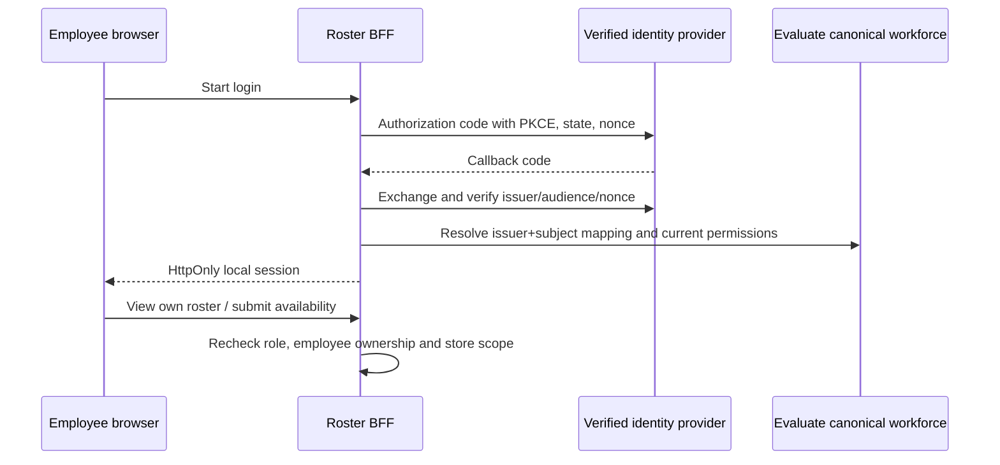

# Molly Staff 员工中心整合评估

本文件仅评估，不实施整合。目标 https://staff.mollytea.com.au，检查日期 2026-11-17。可取得 Roster 与 Evaluate 完整业务源代码及 Staff 公开前端；**未取得 Staff 后端、数据库、身份协议或管理员接口契约**。

## 当前证据与未知项

Staff 首页匿名 GET 200、标题“员工登录”；`/api/people/context?path=/` 与 `/api/people/session` 匿名 GET 均 401。`.well-known/openid-configuration` 返回同一 HTML 登录页而非 JSON discovery，不能据此认定支持 OIDC，也不能断言内部不存在其他协议。没有尝试登录、密码、提权、写入或员工数据读取。

公开 `staff.js`（SHA-256 `9790e20d77fc3db1151b280807f397deb42a3254759a07fb68e492e783a3d2f0`）引用 `/api/login`、`/api/logout`、`/api/people/context`、roles/access 等管理接口，以及 `/api/native/xero-permissions`。这只证明前端存在调用入口，**不能证明 Xero/SSO 已真实集成**。公开 store-scope 脚本的三项映射已核实，详见 STORE_MAPPING。Staff 后端 session cookie、TTL、密钥轮换、撤销和 API 权限实现待验证。

## 推荐架构（未来实现）

1. 先向 Staff 维护者取得服务端认证和员工/门店数据契约，决定其是否能成为 IdP；支持标准 OAuth/OIDC 时首选 Authorization Code + PKCE，Roster 服务端换取并验证 token，再创建本地短期会话。若没有 IdP 能力，先引入共同身份提供者或受控 BFF，不采用共享明文密码或浏览器模拟登录。
2. 增加身份映射表：唯一 `(issuer, subject)` → `Evaluate Employee.id`；管理员账号可另绑定既有 UserAccount。email/姓名只能作人工建议，不能作为永久主键或自动合并依据。离职停用身份与会话，保留员工 ID 和历史排班引用。
3. 继续由 Evaluate 管理 canonical employee、技能、正式分数；若 Staff 被确定为员工资料权威系统，通过外部 ID 映射和版本化同步更新 Evaluate，而非让 Roster 两边同时改同一员工资料。逐字段确认权威来源，包括 home store、姓名、状态与岗位；评价数据仍由 Evaluate 管理。
4. 独立同步 ManagementStoreScope。普通员工只可访问本人；店长管理指定店；区域管理多店；系统管理员全店。home store 单独保存，转店不授予管理权限，管理跨店也不改变员工归属。

## Cookie、CORS、CSRF 与退出

当前 Sites `chatgpt.site` 与 `mollytea.com.au` 不是同一可注册域，不能共享 Domain Cookie。建议由 Roster BFF 承担跨站认证，浏览器只持本地 HttpOnly/Secure 会话，token 留服务器。跨 origin API 仅允许明确 origin、credentials、方法，禁止 `*` 与凭据组合。OAuth state/nonce/PKCE 防止回调替换；验证签名、issuer、audience、过期及 subject，防止把任意 ID token 当 API token。Cookie 写操作还需 Origin/CSRF 验证。

用户退出应撤销 Roster 本地会话；全局退出、Staff 离职/权限变化如何及时撤销需 IdP 契约支持（back-channel/logout事件或短 TTL 与重新检查）。避免浏览器 localStorage 保存长期 access/refresh token。域名统一或反向代理是另外的上线项目，不在本交接任务范围内。

## 员工与门店同步

先只读导入对照表并人工解决冲突；员工 canonical ID 不变。新员工通过 Staff 外部 ID 唯一创建映射；离职 archive/isActive=false、禁用登录但保留历史；转店以当前 Evaluate EmployeeService 事务同步相关可变门店元数据，保留 CLOSED 历史；重新入职按业务政策恢复既有身份，不能凭姓名新建重复员工。冲突队列显示重复外部ID、缺失员工、跨店歧义，支持显式审核与审计。

门店映射独立于员工映射，保留 B130→bw 130、MBL→baking lab、CH→CW。HV/GS 与现有 Roster 两店只作候选。正式映射必须由两系统管理员确认，唯一约束保证一个外部 code 不静默指向两个内部店。

## 可复用与需新增

可复用：Evaluate `auth.ts`（本地 session）、`employeeService.ts`、`accountService.ts`、`storeService.ts`、`rosterIntegrationService.ts`，Roster `auth.ts`、`rosterService.ts`、workforce/availability/period/publication API；路径以 API_REFERENCE 为准。

需适配：`production-site/server/evaluate.mjs` 与 `evaluate-auth.mjs`、两个前端 AuthContext、API Client、人员/门店查询投影、权限更新和失效机制。需新增：OIDC client 或身份适配器、issuer+subject 映射、外部门店映射、幂等增量同步与冲突审计、真实员工 owner 权限/通知确认。模拟员工 routes 不应直接改名作为正式权限实现。

建议顺序：取得 Staff 后端/协议 → 对齐 ID/门店与权威源 → 做只读同步/冲突报告 → 独立测试 SSO 与退出撤销 → 真实员工只读本人班表 → 本人报班写入及并发验证 → 管理 scope 联调 → 预发布全流程验收后另行审批上线。

验收覆盖：普通员工不能查看/修改别人和别店；店长/区域 scope 变化立即生效；重复回调和同步幂等；账号停用/离职/转店/重入职；同名不同人；B130/MBL/CH-CW 不混店；CORS/CSRF/重放/失效 token；既有 CLOSED 评价、班表快照和导出保持正确。风险集中在缺失 Staff 服务端资料、身份缺少绑定、scope 语义不一致以及历史迁移中的错误主键合并。

协议参考：[OpenID Connect Core 1.0](https://openid.net/specs/openid-connect-core-1_0.html)，身份解析使用 issuer+subject，服务端验证签名与 audience/nonce；这是一项未来建议，不表示 Staff 已实现该协议。
