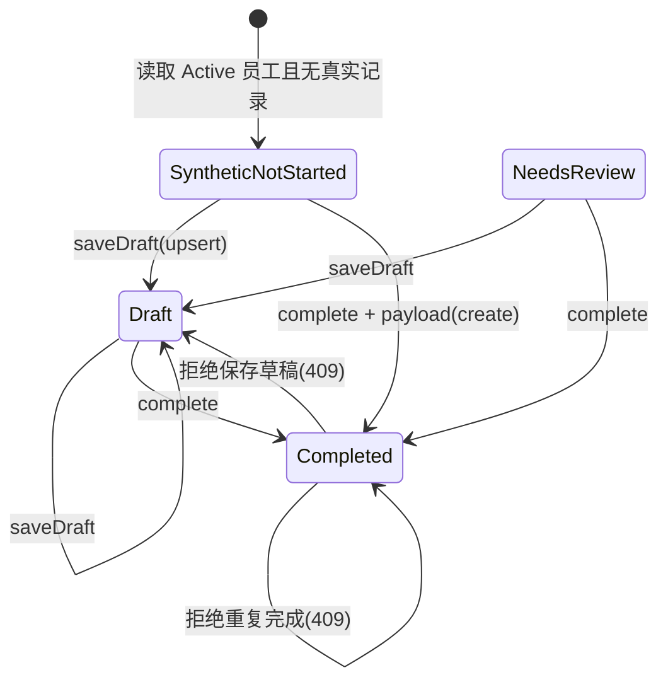

# 员工评价系统完整项目审计报告

审计日期：2026-08-11（Australia/Sydney）  
审计范围：`E:\PY Study\Evaluate Molly` 当前工作区  
审计方式：源码、配置、Prisma schema、migration、前后端调用链、测试与只读命令核验  
限制：当前目录不是 Git 仓库；未执行 build、migration、seed、reset；未对真实数据库执行写操作；未进行真实身份提供方、生产部署、浏览器 E2E 或数据库并发压测。

## 1. Executive Summary

### 总体判断

- **当前成熟度**：功能型原型 / 早期内部工具。主要页面和核心评价流程已形成，类型检查、lint、单元测试均通过，但身份认证、历史数据不可变性、删除策略和统计语义尚未达到生产标准。
- **是否适合继续开发**：适合。前后端边界基本清楚，Zod、Prisma、service 和 fallback 已有可扩展基础。
- **是否适合内部试用**：仅限不含真实敏感员工资料、隔离网络、可随时清库的测试环境。修复 P0 后才建议使用真实数据试用。
- **是否适合生产部署**：**不建议部署**。
- **问题统计**：Critical 2，High 8，Medium 12，Low 1，共 23 项。

### 最严重的三个问题

1. 客户端可自行声明 `Admin`、`AreaManager`、`StoreManager` 和门店范围；运行中的开发服务无请求头也直接获得 Admin。见 AUDIT-001。
2. Admin 强制删除门店会通过级联删除员工、评价历史、活动、绩效备注和 AI 审计记录；结合可伪造 Admin，存在不可逆数据损坏风险。见 AUDIT-002。
3. 工作区内的 `backend/.env` 含非空外部 AI 密钥和数据库连接配置，但 `.gitignore` 未忽略 `.env`。见 AUDIT-003。

### 审计置信度

- **代码与静态契约：高**。已覆盖全部业务源码、路由、schema、migration、前端 repository、页面入口和测试清单。
- **运行时权限缺陷：高**。除源码证据外，已在当前服务只读验证：无请求头访问门店接口返回 200；伪造 Admin 请求头访问管理接口也返回 200。
- **数据库并发、生产网络和真实 AI 提供方：中/低**。未进行写入并发测试、生产身份集成或真实外部模型调用。
- **UI 视觉和辅助技术：中**。完成代码级响应式、焦点、label、状态和 reduced-motion 审计，未进行屏幕阅读器与多浏览器实测。

## 2. 实际项目架构

### 前端

- React 19、TypeScript 5.9、Vite 7、React Router 7、Tailwind CSS 3。
- 动效：Framer Motion、GSAP；图表：Recharts；图标：Lucide React。
- 页面路由定义于 `src/App.tsx:31-53`：Dashboard、Store、Evaluation Form、History、Analytics、Employees、Stores 均存在。
- 数据访问集中在 `src/services/*Repository.ts`，但响应 DTO 由前端手写，没有共享 schema 或运行时响应校验。
- 后端不可用时读取 `src/data/mockEvaluations.ts`；全局 fallback 状态位于 `src/services/fallbackStatus.ts`。

### 后端

- Node.js、TypeScript、Express 5、Prisma 6、Zod 4。
- `backend/src/routes.ts` 同时承担路由、认证上下文读取、授权、解析、AI 编排和错误映射，尚无 controller 层。
- 业务 service：`EvaluationService`、`EmployeeService`、`StoreService`、`PerformanceNoteService`、`AiEvaluationService`、`AiAnalysisRunService`。
- 单例 Prisma Client 位于 `backend/src/prisma.ts:1-3`，单进程内不会为每个请求重复创建连接。

### 数据库

- PostgreSQL；Prisma schema 位于 `backend/prisma/schema.prisma`。
- 核心模型：`Store`、`Employee`、`Evaluation`、`EvaluationActivity`、`PerformanceNote`、`AiAnalysisRun`。
- **不存在 `EvaluationPeriod` 模型**。`Evaluation.evaluationPeriod` 只是普通字符串（`schema.prisma:101`）。
- `Evaluation` 使用 `@@unique([employeeId, storeId, evaluationPeriod])`（`schema.prisma:132`）。
- Store/Employee 关系大量使用 `onDelete: Cascade`（`schema.prisma:84,121-122,158-159,178-179,199-200`）。

### 关键数据流

```text
页面 -> 前端 Repository -> fetch + 可伪造开发请求头 -> Express Router
     -> Zod 请求校验 -> Store 范围检查 -> Service -> Prisma -> PostgreSQL

网络 TypeError -> Mock fallback -> 全局只读标识 -> Repository 写入前拦截

评价文本 -> 后端 AI Service -> Local 规则或 DeepSeek -> AI 结果回表单
         -> 用户 Save/Complete -> 后端重算 finalScore -> Evaluation 持久化
```

### 与预期架构的偏差

- 技术栈基本符合预期。
- 产品代码已转为“随时评分”：新评价标签由 `Instant YYYY-MM-DD HH:mm:ss` 生成（`evaluationService.ts:690-692`），但数据库、DTO、mock 和文档仍保留 period 命名和季度数据。
- 不存在 Active/Completed/Archived 周期实体或周期状态机，也不存在 reopen 路由。
- 没有真实认证提供方；所谓权限仅依赖客户端请求头。
- “简单数据导出”未实现。

## 3. 功能完成度矩阵

| 模块 | 状态 | 证据 | 主要缺陷 | 结论 |
| -- | -- | -- | ---- | -- |
| Dashboard | 部分实现 | `src/pages/DashboardPage.tsx`；`EvaluationService.getDashboard` | 全局平均为未加权门店平均；Draft 进入评分统计；门店筛选不完整 | 可展示，不可作为严肃统计口径 |
| Store 评价列表 | 部分实现 | `StoreEvaluationPage.tsx`；`getStoreEvaluations` | Synthetic 仅靠 ID/状态表达；内存 overlay 后分页 | 500 人可用，增长后需重构 |
| Evaluation Form | 部分实现 | `EvaluationFormPage.tsx`；draft/complete 路由 | 身份可伪造、AI 分可伪造、无离页未保存提醒 | 主流程存在，审计可信度不足 |
| 草稿保存 | 完整实现 | `saveDraft` 使用复合键 upsert，`evaluationService.ts:407-465` | 无版本号/乐观锁，最后写入覆盖 | 单用户流程完整 |
| 完成评价 | 部分实现 | `completeEvaluation`，`evaluationService.ts:468-535` | Synthetic 并发首次完成可能 500；调店后旧门店可完成旧草稿 | 不满足严格一致性 |
| History | 部分实现 | `getEmployeeHistory`、`listHistoryIndex` | 姓名/角色非快照；调店后趋势被门店拆分；无分页 | 可读但历史语义不完整 |
| Analytics | 部分实现 | `getAnalytics`，`evaluationService.ts:331-367` | Draft 污染正式分析；查询和聚合扩展性有限 | 仅适合演示 |
| 员工管理 | 部分实现 | `EmployeeService`、`EmployeeManagementPage` | 只有归档，无业务唯一编号/邮箱约束；历史显示会随员工字段改变 | 基础 CRUD/归档存在 |
| 门店管理 | 部分实现 | `StoreService`、`StoreManagementPage` | 强制硬删除级联销毁历史 | 高风险管理功能 |
| 评价周期管理 | 未实现 | schema 无 Period 模型；路由只有 distinct 字符串读取 | 无周期状态、唯一 Active、Archived 只读 | 与本审计周期语义不符 |
| reopen | 未实现 | `routes.ts` 无 reopen；旧文档仍声称存在 | `NeedsReview` 无入口 | 文档与代码漂移 |
| AI 文本分析 | 部分实现 | `AiEvaluationService`、`/evaluations/analyze-text` | 隐私控制、限流、AI 分来源可信性不足 | 技术链路存在，治理不足 |
| Fallback | 部分实现 | `fallbackStatus.ts`；各 repository | 全局状态可被部分成功请求清除；无超时；部分 fallback 统计不真实 | 写入不会落 mock，但体验/状态仍有风险 |
| 数据导出 | 未实现 | 全项目搜索无 CSV/Blob/download/export 实现 | 核心预期缺口 | 需新增 |
| 权限控制 | 占位实现 | `auth.ts`、`apiAuth.ts` | 身份和范围完全由客户端声明 | 不构成生产安全边界 |

## 4. 问题清单

#### AUDIT-001：客户端可伪造身份、角色和门店范围

* 严重程度：Critical
* 类别：Security
* 证据：`backend/src/auth.ts:13-41` 的 `getAuthContext` 直接信任 `x-user-*`；`src/services/apiAuth.ts:38-44` 从可编辑 localStorage 生成请求头；`src/components/layout/AppShell.tsx:56-93` 提供角色和门店编辑 UI。
* 当前行为：任意客户端可声明自己为 Admin，或把任意门店加入 `x-store-ids`。非 production 且无头部时自动成为 `dev-admin`（`auth.ts:21-26`）。当前运行服务只读实测：无头部 `/api/stores` 为 200，伪造 Admin 的 `/api/stores/manage` 为 200。
* 预期行为：身份由可信 SSO/JWT/session/mTLS 或受信反向代理注入；后端验证签名、受众、过期时间和服务端角色/门店授权。
* 复现条件：修改 localStorage、直接 curl/fetch 自定义请求头，或在非 production 环境省略请求头。
* 影响范围：所有员工、评价、备注、AI、分析及门店管理接口；同时造成水平越权、垂直越权、身份伪造和 IDOR 基础条件。
* 根因：开发身份模拟被当成正式认证上下文，未建立可信身份边界。
* 修复建议：接入真实认证中间件；服务端按 `userId` 查询角色和门店；生产构建移除 Dev access；拒绝来自公网客户端的身份头，或仅接受网关注入且清洗同名外部头。
* 修复复杂度：L
* 是否阻塞上线：是
* 置信度：高

#### AUDIT-002：强制删除门店会不可逆级联删除全部历史

* 严重程度：Critical
* 类别：Data Integrity
* 证据：`backend/src/storeService.ts:61-83` 允许 `force` 后直接 `store.delete`；`backend/src/routes.ts:74-79` 暴露 `?force=1`；所有相关 FK 为 Cascade（`backend/prisma/schema.prisma:84,121-122,158-159,178-179,199-200`）。
* 当前行为：强制删除一个门店将删除其员工，并进一步删除评价、活动、备注和 AI 审计数据。返回的 `deletedLinkedRecords` 只是预删除计数，不是可恢复备份。
* 预期行为：生产系统应归档门店，或要求显式数据迁移、审计审批和可恢复备份；历史记录应保留。
* 复现条件：以 Admin 身份调用 `DELETE /api/stores/:id?force=1`。
* 影响范围：整店历史和全部关联员工数据；结合 AUDIT-001 可由未授权人员触发。
* 根因：将“强制删除”实现为数据库级硬删除，历史与运营实体共享级联生命周期。
* 修复建议：引入 Store Archived 状态；生产禁用级联硬删除；必要删除改为后台受审计任务，并要求备份、二次身份校验和影响预览。
* 修复复杂度：L
* 是否阻塞上线：是
* 置信度：高

#### AUDIT-003：真实环境文件含敏感配置且未被 Git 忽略

* 严重程度：High
* 类别：Security
* 证据：`backend/.env` 存在非空 `DATABASE_URL` 和 `DEEPSEEK_API_KEY`；根 `.gitignore` 未包含 `.env`；`backend/.env.example` 不存在。
* 当前行为：敏感配置位于工作区普通文件中，存在误提交、打包、备份或共享风险。
* 预期行为：秘密由 secret manager/部署环境注入；`.env` 被明确忽略；仓库只保留不含值的示例文件。
* 复现条件：初始化 Git 后执行普通 `git add .`，或共享整个目录。
* 影响范围：数据库和外部 AI 账户。当前无 Git 元数据，无法确认是否已泄露。
* 根因：秘密管理和仓库忽略规则不完整。
* 修复建议：立即轮换现有密钥和数据库凭据；忽略 `.env*`（保留 example）；添加后端示例配置和泄密扫描。
* 修复复杂度：S
* 是否阻塞上线：是
* 置信度：高

#### AUDIT-004：评价周期状态机完全不存在，代码与旧文档互相矛盾

* 严重程度：High
* 类别：Business Logic
* 证据：schema 只有 `Evaluation.evaluationPeriod String`（`schema.prisma:101`）；`listPeriods` 仅做 distinct（`evaluationService.ts:64-71`）；路由无周期管理和 reopen。反之 `docs/evaluation-api-contract.md:58-73` 仍声明 reopen 和 Needs Review 流程存在。
* 当前行为：无法表达 Active/Completed/Archived，也无法后端强制 Archived 只读、唯一 Active 或周期切换规则。当前实际产品是秒级时间标签的随时评分。
* 预期行为：二选一并明确：若采用周期制，建立 Period 实体和完整后端状态机；若“随时评分”为权威需求，删除周期状态假设、季度 mock 和失效文档，将字段重命名为明确的评价批次/时间标识。
* 复现条件：尝试归档周期、reopen 或限制 Completed 周期写入。
* 影响范围：周期筛选、统计、Synthetic、状态机、文档和测试。
* 根因：产品方向从周期评分改为随时评分后，只改了部分链路。
* 修复建议：先冻结产品语义决策，再一次性统一 schema、DTO、路由、文档和测试。
* 修复复杂度：L
* 是否阻塞上线：是（若周期语义仍是正式需求）；否则阻塞契约清理
* 置信度：高

#### AUDIT-005：员工调店后，旧门店经理仍可完成旧门店草稿

* 严重程度：High
* 类别：Security
* 证据：complete 路由仅按评价自身 `storeId` 授权（`routes.ts:336-345`）；`completeEvaluation` 对现有评价只检查员工是否 Archived，不检查 `existing.employee.storeId === existing.storeId`（`evaluationService.ts:468-483`）。
* 当前行为：员工从 A 店调到 B 店后，只要 A 店存在未完成评价，A 店经理可凭评价 ID 完成该评价；而 `saveDraft` 会因员工/门店组合不匹配而拒绝，两个写入口语义不一致。
* 预期行为：明确调店策略；通常应冻结旧草稿、迁移归属或要求 AreaManager/Admin 决策，不能让旧店普通经理继续提交当前评价。
* 复现条件：A 店创建 Draft，员工转到 B 店，A 店经理调用 complete。
* 影响范围：跨店评价归属、水平越权和绩效决策。
* 根因：完成路径信任旧 Evaluation.storeId，未同时校验员工当前归属和业务权限。
* 修复建议：在事务中校验员工当前门店、评价版本和操作者角色；为调店建立显式策略与测试。
* 修复复杂度：M
* 是否阻塞上线：是
* 置信度：高

#### AUDIT-006：历史记录未保存员工身份快照，后续修改会重写历史展示语义

* 严重程度：High
* 类别：Data Integrity
* 证据：Evaluation 仅保存 `employeeId`、`storeId`，没有 employeeName/role 快照（`schema.prisma:96-133`）；`toFrontendHistoryEntry` 从当前 `evaluation.employee.name` 和 `role` 读取（`domain.ts:202-225`）。
* 当前行为：员工改名、改角色或调店后，旧评价展示当前姓名和角色，而非完成评价当时的值；History Index 又按 `storeId:employeeId` 分组（`EvaluationHistoryIndexPage.tsx:44-69`），跨店趋势被拆开。
* 预期行为：正式历史记录保留完成时员工姓名、角色、门店显示名、评分规则版本等快照；调店不改写历史事实。
* 复现条件：完成评价后修改员工姓名/角色或转店，再打开历史。
* 影响范围：审计、争议处理、趋势分析和报表。
* 根因：历史 DTO 动态 join 当前 Employee，而不是不可变快照。
* 修复建议：完成时写入快照字段和 scoringVersion；历史按员工全局标识串联，同时保留评价时门店维度。
* 修复复杂度：L
* 是否阻塞上线：是
* 置信度：高

#### AUDIT-007：AI 分数和评价人身份可由客户端伪造

* 严重程度：High
* 类别：Data Integrity
* 证据：draft/complete payload 接受客户端 `evaluatorId`、`aiTextScore`、`aiRiskScore`（`validation.ts:19-28`）；service 直接保存这些字段（`evaluationService.ts:438-457,520-526,578-588`），没有校验 AI run 或用 `auth.userId` 覆盖 evaluator。
* 当前行为：直接请求可把任意 0-100 数值声称为 AI 输出，也可伪造评价人 ID。后端会重算 finalScore，但重算使用伪造的 AI 分。
* 预期行为：评价人来自可信认证上下文；AI 分来自服务端签发/关联的成功 AiAnalysisRun，或明确标注为人工覆盖并记录原因。
* 复现条件：绕过 UI，POST draft/complete 自定义 evaluatorId 和 AI 分。
* 影响范围：最终分、风险等级、审计人、Analytics。
* 根因：请求 DTO 同时承载用户输入和受信计算结果，未区分来源。
* 修复建议：路由将 `auth.userId` 注入 service；payload 不接受 evaluatorId；AI 分使用 runId 关联并服务端读取，人工覆盖单独建审计字段。
* 修复复杂度：M
* 是否阻塞上线：是
* 置信度：高

#### AUDIT-008：最终分可能小于 0，不满足 0-100 评分语义

* 严重程度：High
* 类别：Business Logic
* 证据：前后端公式一致但最终值未 clamp：`manual*0.75 + aiText*0.2 - aiRisk*0.05`（`backend/src/scoring.ts:26-31`、`src/lib/scoring.ts:37-42`）。
* 当前行为：所有人工分和 AI 文本分为 0、风险分为 100 时，finalScore 为 -5。Zod 只限制输入，不限制计算结果。
* 预期行为：若产品定义总分为 0-100，应在唯一服务端公式中 clamp，并明确最高分、最低分、舍入和风险扣分规则。
* 复现条件：提交最低绩效分和最高风险分。
* 影响范围：等级、排序、图表和导出。
* 根因：只 clamp 公式输入，未 clamp 输出，也没有分数不变量测试。
* 修复建议：服务端输出 clamp 到 0-100；共享或生成前端公式；增加边界性质测试。
* 修复复杂度：S
* 是否阻塞上线：是
* 置信度：高

#### AUDIT-009：Draft 被当作正式评分进入 Dashboard 和 Analytics

* 严重程度：High
* 类别：Business Logic
* 证据：`getStoreSummaries` 仅排除 `NotStarted`，Draft 进入平均分和风险（`evaluationService.ts:235-256`）；Analytics top performers、弱项和风险分布同样只排除 NotStarted 或完全不排除（`evaluationService.ts:331-365,380-404`）。
* 当前行为：保存一个默认 75/70/30 的草稿即可改变门店平均、Top performer、弱项和风险统计，尽管评价未完成。
* 预期行为：正式绩效 Analytics 默认只使用 Completed；Draft 应单独用于进度和待办指标，并在 UI 明确标识。
* 复现条件：新建或修改 Draft 后查看 Dashboard/Analytics。
* 影响范围：管理决策和跨店比较。
* 根因：`evaluationStatus !== NotStarted` 被误用为“有效正式得分”。
* 修复建议：定义统计口径矩阵；Completed 作为正式分，Draft 仅用于 workflow 指标；API 返回口径元数据。
* 修复复杂度：M
* 是否阻塞上线：是
* 置信度：高

#### AUDIT-010：敏感评价可发送外部模型，缺少治理和限流

* 严重程度：High
* 类别：Security
* 证据：`AiEvaluationService.buildMessages` 发送员工 ID、姓名、门店、经理评价和最多 10 条近期备注（`aiEvaluationService.ts:301-328`）；`routes.ts:261-327` 无速率限制/配额；AiAnalysisRun 保存完整 `textReviewSnapshot`（`schema.prisma:146`）。
* 当前行为：配置 DeepSeek 后，敏感绩效信息直接发送外部服务；任何拥有门店头部权限的客户端可反复调用并产生费用。没有同意、脱敏、数据驻留、保留期或 DLP 控制证据。
* 预期行为：明确数据处理协议、最小化/脱敏、租户开关、调用配额、审计、保留期和用户提示。
* 复现条件：AI provider 设为 deepseek 并调用 analyze-text。
* 影响范围：员工隐私、合规、供应商风险和成本。
* 根因：AI 功能先实现技术调用，未建立数据治理控制面。
* 修复建议：默认禁用外发；增加服务端策略开关、脱敏、速率限制、配额、数据分类和 retention；评估是否需要完全本地模型。
* 修复复杂度：L
* 是否阻塞上线：是（启用外部 AI 时）
* 置信度：高

#### AUDIT-011：Synthetic 首次直接完成存在并发竞争

* 严重程度：Medium
* 类别：Data Integrity
* 证据：`completeEvaluation` 先 find 再调用 `createCompletedFromPayload`（`evaluationService.ts:468-476,563-597`）；create 依赖复合唯一约束，但没有 transaction/upsert/冲突映射。
* 当前行为：两个并发首次完成请求都可能查到不存在；一个创建成功，另一个触发 Prisma 唯一冲突并被全局错误处理成 500。唯一约束可防重复行，但不能提供幂等响应。
* 预期行为：同一 Synthetic 的重复/并发完成应只生成一个真实评价，并返回一致结果或明确 409。
* 复现条件：并发提交同 employee/store/evaluationPeriod 的 synthetic complete。
* 影响范围：重复点击、网络重试和移动端弱网。
* 根因：check-then-create 非原子，未使用幂等键或冲突恢复。
* 修复建议：事务/upsert + 条件状态更新；添加 idempotency key；映射 Prisma P2002。
* 修复复杂度：M
* 是否阻塞上线：否（但应在内部试用前修复）
* 置信度：高

#### AUDIT-012：Synthetic 边界依赖字符串 ID 和状态，没有显式字段

* 严重程度：Medium
* 类别：API
* 证据：Synthetic ID 由 `synthetic:${store}:${employee}:${period}` 组成（`domain.ts:173-199`）；前端 Evaluation 只有注释，没有 `isSynthetic`（`src/types/evaluation.ts:40-65`）；动作主要依据 `evaluationStatus` 和 URL（`EmployeeEvaluationTable.tsx:187-193`）。
* 当前行为：Synthetic 与真实对象共用 DTO；秒级 period 含冒号；任何不存在的 evaluationId 配合合法 payload 都会走“新建并完成”，并不只接受 synthetic 前缀。
* 预期行为：显式 `isSynthetic`/`recordKind`，写接口使用 employee/store/batch 的明确 create 语义，update/complete-real 只接受真实 ID。
* 复现条件：提交任意不存在的 evaluationId 和合法 payload。
* 影响范围：API 可理解性、客户端漂移和错误路由。
* 根因：读取层虚拟资源与持久化资源复用同一标识契约。
* 修复建议：拆分 Assignment DTO 与 Evaluation DTO；为首次完成提供明确 create endpoint。
* 修复复杂度：M
* 是否阻塞上线：否
* 置信度：高

#### AUDIT-013：Dashboard 全局平均分使用未加权门店平均

* 严重程度：Medium
* 类别：Business Logic
* 证据：前端按 `summaries.length` 平均各门店平均分（`DashboardPage.tsx:66-71`），覆盖后端按全部评价计算的 `dashboardData.kpis.averageFinalScore`。
* 当前行为：10 人门店和 100 人门店权重相同；门店规模不同时全局平均错误。
* 预期行为：使用后端全体评价加权平均，或按人数/完成数显式加权。
* 复现条件：至少两个员工数不同且平均分不同的门店。
* 影响范围：Dashboard 核心 KPI。
* 根因：前端重复聚合并改变统计口径。
* 修复建议：全局时直接使用服务端 KPI；门店筛选由后端返回完整 scoped dashboard。
* 修复复杂度：S
* 是否阻塞上线：否
* 置信度：高

#### AUDIT-014：Dashboard 门店筛选在截断后再过滤，活动仍未过滤

* 严重程度：Medium
* 类别：Business Logic
* 证据：后端 needsAttention 先全局 `.slice(0,5)`（`evaluationService.ts:289-291`）；前端之后按 store 过滤（`DashboardPage.tsx:75-79`）；activities 始终使用全部返回值。
* 当前行为：选中门店可能漏掉该店真实需要关注的员工，且 Recent Activity 仍显示其他门店。
* 预期行为：storeId 应在数据库查询和 limit 前作用于所有 Dashboard 子集。
* 复现条件：目标门店的风险员工未进入全局前五，或授权范围含多个门店活动。
* 影响范围：门店经理注意力列表和操作理解。
* 根因：筛选职责拆分在前后端，scope 语义不完整。
* 修复建议：服务端统一 scope 后聚合、排序、limit；前端不重复裁剪业务数据。
* 修复复杂度：M
* 是否阻塞上线：否
* 置信度：高

#### AUDIT-015：历史和 latest 查询无分页并在内存去重，数据增长后退化

* 严重程度：Medium
* 类别：Performance
* 证据：`getLatestEvaluationRows` 读取匹配的全部历史后用 Map 去重（`evaluationService.ts:621-645`）；`listHistoryIndex` 无 take/分页且用 slice/reverse 为每行找 previous，形成 O(n²)（`evaluationService.ts:312-328`）；前端一次加载全部 history（`EvaluationHistoryIndexPage.tsx:22-30`）。
* 当前行为：500 人、多次随时评分后，Dashboard/Analytics/History 传输和内存工作量随历史总量增长，而不是员工数增长。
* 预期行为：数据库窗口函数/distinct-on/subquery 取 latest；History 服务端分页；previous grade 用窗口或单次 Map。
* 复现条件：每名员工积累大量历史评价。
* 影响范围：Dashboard、Analytics、History 响应时间和 Node 内存。
* 根因：原型期内存聚合延续到主链路。
* 修复建议：引入专用查询/repository；按常用 scope 建组合索引并用 EXPLAIN 验证。
* 修复复杂度：L
* 是否阻塞上线：否
* 置信度：高

#### AUDIT-016：员工缺少业务唯一标识和重复约束

* 严重程度：Medium
* 类别：Database
* 证据：Employee 只有 cuid 主键、name、role 等字段（`schema.prisma:73-94`）；没有 employeeNumber/email，也没有业务 `@@unique`。
* 当前行为：同名员工可无限重复，无法可靠导入、对账或跨店识别；前端允许可选自定义 id，但不是稳定业务规则。
* 预期行为：至少一个组织级稳定员工编号唯一；邮箱若使用则规范化后唯一或按业务允许空值。
* 复现条件：重复创建相同姓名/门店/角色员工。
* 影响范围：评价归属、调店、导入和历史追踪。
* 根因：数据模型以演示身份为主。
* 修复建议：新增不可变 employeeNumber，制定重复检测和合并策略。
* 修复复杂度：M
* 是否阻塞上线：否
* 置信度：高

#### AUDIT-017：前端 API 类型为手写断言，无响应运行时校验

* 严重程度：Medium
* 类别：API
* 证据：各 repository 使用 `response.json() as Promise<T>`（如 `evaluationRepository.ts:311-332`、`employeeRepository.ts:126-147`）；前端类型与后端 Zod/Prisma 不共享。
* 当前行为：后端缺字段、null 漂移、枚举变化或错误代理返回 200 时，前端在页面深处崩溃或显示 NaN，而不是在 API 边界报契约错误。
* 预期行为：OpenAPI/共享 Zod 生成 DTO，或前端对响应 parse。
* 复现条件：API 返回缺少 manualScores、stores、items 或错误枚举的 200 JSON。
* 影响范围：全部页面。
* 根因：只有请求 Zod 校验，没有响应契约单一来源。
* 修复建议：定义 transport DTO schema；服务端输出和前端输入共同验证；增加 contract tests。
* 修复复杂度：L
* 是否阻塞上线：否
* 置信度：高

#### AUDIT-018：Fallback 是全局布尔状态，部分恢复会错误解除只读提示

* 严重程度：Medium
* 类别：Frontend
* 证据：`fallbackStatus.ts:8-40` 只有单一 snapshot；任何同 generation 的成功读取可 `markApiAvailable` 清除；repositories 只把 `TypeError` 视为不可用且 fetch 无 timeout（如 `evaluationRepository.ts:311-336`）。
* 当前行为：一个 API 模块成功可清除另一个模块仍在 fallback 的状态；UI 重新启用写按钮，但写请求仍可能失败。挂起请求没有超时，不会进入 fallback。Store fallback 的 linked counts 固定为 0（`storeRepository.ts:31-42`）。
* 预期行为：按 endpoint/domain 跟踪健康状态，只有所有 fallback 数据被实时数据替换后解除；请求有明确超时；数据来源在对象或页面级标识。
* 复现条件：部分 API/代理路径失败、另一路径成功，或后端连接挂起。
* 影响范围：只读状态、门店删除提示和用户信任。
* 根因：fallback 状态粒度过粗。
* 修复建议：按资源维护状态机和请求超时；写 service 始终只走 API且显示具体不可用原因。
* 修复复杂度：M
* 是否阻塞上线：否
* 置信度：高

#### AUDIT-019：错误映射和可观测性不足

* 严重程度：Medium
* 类别：Backend
* 证据：全局 handler 将任意 Error.message 返回客户端（`routes.ts:348-360`）；未见 Prisma P2002/P2025 映射、request ID、结构化日志或审计日志；`server.ts:17-18` 仅启动日志。
* 当前行为：并发唯一冲突等系统错误成为 500 且可能暴露底层消息；无法跨前端、API、DB、AI run 关联一次请求。
* 预期行为：业务错误、验证错误、认证错误和系统错误分层；生产隐藏内部细节并记录 requestId、用户、门店、资源和耗时。
* 复现条件：Prisma 唯一冲突、连接失败或未知异常。
* 影响范围：排障、安全信息暴露和重复提交处理。
* 根因：错误处理仍是最小原型实现。
* 修复建议：统一 AppError、Prisma 错误映射、request ID 和结构化日志；敏感字段脱敏。
* 修复复杂度：M
* 是否阻塞上线：否
* 置信度：高

#### AUDIT-020：简单数据导出未实现

* 严重程度：Medium
* 类别：Business Logic
* 证据：全项目搜索 `CSV`、`Blob`、`download`、`createObjectURL`、xlsx 未发现导出链路；路由无 export endpoint。
* 当前行为：无法导出员工、历史或分析数据。
* 预期行为：按权限和当前筛选导出 CSV；大数据量由后端流式生成并记录审计。
* 复现条件：任意页面寻找导出操作。
* 影响范围：管理对账、归档和离线分析。
* 根因：功能尚未实现。
* 修复建议：先定义导出字段、权限、时区和敏感字段策略，再实现服务端导出。
* 修复复杂度：M
* 是否阻塞上线：否
* 置信度：高

#### AUDIT-021：测试未覆盖真实安全边界、并发和数据库集成，且无 CI

* 严重程度：Medium
* 类别：Testing
* 证据：前端 Vitest 使用 node 环境，仅 repository 测试；后端 service 使用内存 mock，route 注入 mock service；没有 `.github` CI 目录。现有 `auth.test.ts:25-32` 反而确认无头部 Dev Admin 为预期。
* 当前行为：43 前端测试和 81 后端测试都通过，但没有真实 PostgreSQL、并发、React 组件、E2E、生产身份、force delete、调店后完成、历史快照测试。
* 预期行为：CI 运行 lint/typecheck/test/build；Testcontainers/隔离 DB 验证约束和事务；E2E 验证权限和 fallback UI。
* 复现条件：检查测试目录和 CI 配置。
* 影响范围：上线回归置信度。
* 根因：测试集中于 happy path 和 mocked contract。
* 修复建议：按第 9 节优先级补测试，并把安全场景设为 CI gate。
* 修复复杂度：L
* 是否阻塞上线：否（P0 修复必须配套测试）
* 置信度：高

#### AUDIT-022：表单缺少离页保护，部分可访问性与角色反馈不完整

* 严重程度：Medium
* 类别：UX
* 证据：Evaluation Form 没有 beforeunload/router blocker；manager textarea 只有相邻标题，没有关联 label/aria-labelledby（`EvaluationFormPage.tsx:396-408`）；桌面图标按钮多为 36-40px（`EmployeeEvaluationTable.tsx:152-165`）；所有角色均看到 Stores 管理和写按钮，非 Admin 只能提交后收到 403（`AppShell.tsx:8-14`）。
* 当前行为：未保存评分可因跳转丢失；辅助技术无法可靠关联 textarea 名称；部分触控目标小于 44px；权限反馈偏事后。
* 预期行为：dirty-state 离页确认、显式 label、44px 触控目标、基于可信权限的禁用/隐藏和解释。
* 复现条件：修改表单后导航；使用屏幕阅读器/触控；以非 Admin 打开 Stores。
* 影响范围：经理工作流、可访问性和误操作。
* 根因：UI 完成了 loading/error/empty/focus/reduced-motion 基础，但未覆盖完整交互生命周期。
* 修复建议：引入表单 dirty 状态与 route blocker；补 label；统一触控尺寸和权限态。保留现有 `focus-visible` 与 reduced-motion 实现。
* 修复复杂度：M
* 是否阻塞上线：否
* 置信度：中

#### AUDIT-023：生产依赖存在一个低危审计项，Prisma 配置已弃用

* 严重程度：Low
* 类别：Maintainability
* 证据：`npm audit --omit=dev --json` 报告生产依赖链 1 个 low（body-parser size enforcement 特定错误配置 DoS）；`prisma validate` 警告 `package.json#prisma` 将在 Prisma 7 移除。
* 当前行为：当前 `express.json()` 未传无效 limit，漏洞可利用性较低；未来 Prisma 升级会要求 config 文件。
* 预期行为：在受控升级中修复依赖并迁移 Prisma 配置。
* 复现条件：运行验证记录中的命令。
* 影响范围：维护性和特定错误配置下可用性。
* 根因：依赖锁定版本包含已知 advisory，配置方式接近弃用期。
* 修复建议：单独变更分支升级并回归测试；不要在本审计轮次自动升级。
* 修复复杂度：S
* 是否阻塞上线：否
* 置信度：高

## 5. 权限矩阵

> 下表是代码“名义权限”。由于 AUDIT-001，角色和门店范围可被客户端伪造，因此当前后端强制并不构成可信安全边界。未认证用户在 production 理论上 401；当前非 production 服务会自动成为 Admin。

| 操作 | Admin | AreaManager | StoreManager | 未认证用户 | 后端是否强制 |
| -- | ----: | ----------: | -----------: | ----: | ------ |
| 查看 Dashboard | 全部门店 | 请求头声明的门店 | 请求头声明的门店 | production 401；dev 等同 Admin | 有 scope，身份不可信 |
| 查看员工 | 全部 | 被声明授权门店 | 被声明授权门店 | production 401；dev 全部 | 有 scope，身份不可信 |
| 创建员工 | 允许 | 被声明授权门店 | 被声明授权门店 | production 401；dev 允许 | 有 store 检查 |
| 修改员工/调店 | 允许 | 源和目标均需授权 | 源和目标均需授权 | production 401；dev 允许 | 有 store 检查 |
| 删除/停用员工 | 仅归档/恢复，无硬删除 | 授权门店可归档/恢复 | 授权门店可归档/恢复 | production 401；dev 允许 | 有 store 检查 |
| 查看评价 | 全部 | 授权门店 | 授权门店 | production 401；dev 全部 | 有 scope，身份不可信 |
| 保存评价 | 允许 | 授权门店 | 授权门店 | production 401；dev 允许 | 有 store 检查 |
| 完成评价 | 允许 | 评价所属授权门店 | 评价所属授权门店 | production 401；dev 允许 | 有，但存在调店缺口 |
| reopen | 404 / 未实现 | 404 / 未实现 | 404 / 未实现 | 404 / 未实现 | 不适用 |
| 查看 Analytics | 全部 | 授权门店 | 授权门店 | production 401；dev 全部 | 有 scope，身份不可信 |
| 管理评价周期 | 未实现 | 未实现 | 未实现 | 未实现 | 否 |
| 创建/修改/删除门店 | 允许 | 禁止（403） | 禁止（403） | production 401；dev 允许 | `requireAdmin`，身份不可信 |
| 创建绩效备注/AI 分析 | 全部 | 授权门店 | 授权门店 | production 401；dev 允许 | 有 store 检查 |

补充：`GET /api/evaluations/periods` 在 `routes.ts:46-48` 完全未调用 `getAuthContext`，未认证也可读取 period 字符串。

## 6. 状态机审计

### 实际状态集合

- Prisma EvaluationStatus：`NotStarted`、`Draft`、`Completed`、`NeedsReview`（`schema.prisma:11-16`）。
- 前端：`Not Started`、`Draft`、`Completed`、`Needs Review`（`src/types/evaluation.ts:1`）。
- Employee 状态：`Active`、`Archived`。Archived 不是评价状态。
- Period 状态：不存在。



### 结论

- `NotStarted` 实际只用于 Synthetic DTO；正常 service 不创建持久化 NotStarted。
- `NeedsReview` 存在于枚举、筛选和统计，但当前没有任何路由把评价转换到 NeedsReview；属于不可达状态。
- 旧文档描述的 `Completed -> NeedsReview -> Draft/Completed` reopen 链路已不存在。
- 完成记录在前端和后端均默认只读，符合当前“完成后新开一次评分”的产品行为。
- Archived 员工不能新建 draft、complete、AI analysis 或 quick note，后端有强制；历史 Completed 可读。
- 不存在 Archived Period，因此无法验证周期级只读、唯一 Active 或周期切换。
- 请求体不能直接提交 `evaluationStatus`，这是正面控制；状态只能通过 draft/complete service 改变。

## 7. API 契约不一致清单

| API | 前端预期 | 后端实际 | 风险 | 建议 |
| --- | ---- | ---- | -- | -- |
| `POST /evaluations/:id/reopen` | 旧文档声称存在 | 路由不存在，返回 404 | 文档/测试/产品理解漂移 | 删除失效文档或恢复明确状态机 |
| `GET /evaluations/periods` | repository 作为认证 API 调用并支持 fallback | 后端不认证，只返回 Evaluation 字符串 distinct | 信息边界不一致 | 加认证或移除遗留 endpoint |
| Dashboard `storeId` | UI 看起来像完整门店筛选 | 后端仅 scope riskOverview；其他数据全局 | 漏项和误导 | 后端统一 scope 全响应 |
| Evaluation DTO | 注释 ID 可能 synthetic，无 `isSynthetic` | 同 DTO 返回虚拟和真实对象 | 客户端只能推断 | 增加 recordKind / 拆 DTO |
| draft/complete evaluator | 前端发送 evaluatorId | 后端直接保存，不用 auth.userId | 审计身份可伪造 | 从认证上下文注入 |
| AI scores | 前端可直接发送数字 | 后端只做范围校验后保存 | AI 来源不可证明 | 通过 runId 服务端取值 |
| Employee/History DTO | 前端认为 history 是已保存记录 | 后端从当前 Employee join 姓名/角色 | 历史展示漂移 | 保存完成时快照 |
| API 响应错误 | 前端只期待 `{message, issues?}` | 任意 Error.message 可能返回 | 内部错误和业务错误混杂 | 标准错误 envelope + code/requestId |
| Store fallback counts | UI 类型表示真实关联计数 | fallback 固定全部为 0 | 可能错误引导删除判断 | 标注 unavailable，不伪造 0 |
| 日期 query | 前端发送字符串 | Zod 仅验证非空，service 直接 `new Date` | Invalid Date 可变成 500 | 使用 `z.coerce.date`/ISO datetime |

其余主要 URL、方法、query 命名和分页结构在当前 repository 与 routes 间基本一致；风险主要来自语义和手写 DTO，而非简单拼写差异。

## 8. 数据模型风险

### 唯一约束

- Evaluation 复合唯一键能防止同 employee/store/evaluationPeriod 重复行，是 Synthetic 保存的关键保护。
- 但 `evaluationPeriod` 为自由字符串，随时评分使用秒级本地时间标签；同一员工同一秒创建两次会冲突，不同时区/格式也没有规范化。
- Employee 无业务唯一键，无法可靠防重。

### 外键与删除策略

- Evaluation 同时关联 Employee 和 Store，可保留评价时 storeId，但数据库不能约束 Evaluation.storeId 必须等于 Employee 当前 storeId。这对历史保留有价值，但写流程必须显式处理调店。
- Store 和 Employee 的 Cascade 会删除全部历史；不符合绩效审计的长期保留需求。
- `AiAnalysisRun.evaluationId` 只是普通可空 String，没有 Evaluation 外键；评价关联无法由数据库保证，可能成为逻辑孤儿。

### 索引

- 现有单列和部分二列索引较完整。
- latest 查询常用 `employeeId/storeId + updatedAt desc`，当前缺少匹配排序的组合索引。
- History 常用 `employeeId/storeId + completedAt`，当前缺少该组合索引。
- 是否真正需要新增必须在目标 PostgreSQL 上用真实数据量 `EXPLAIN (ANALYZE, BUFFERS)` 确认，本轮未连接执行。

### 并发

- saveDraft 的 upsert + unique 可防重复，但无 optimistic version，两个经理同时编辑会最后写入覆盖。
- complete 的首次 create 非原子，见 AUDIT-011。
- complete 与 saveDraft 竞态没有条件更新；读取状态后到 update 之间可能被另一请求改变。

### 历史完整性

- Evaluation 保存分数和文本，但不保存员工/规则快照。
- `manualWeightedScore` 和 `finalScore` 已保存，因此修改代码公式不会自动重算旧记录，这是正面特性；但没有 `scoringVersion`，无法解释历史使用哪套公式。
- 员工归档保留历史；门店强制删除或数据库层删除员工会级联销毁历史。

### Synthetic 边界

- Synthetic 只在读取层生成，数据库没有空评价行，这是正面设计。
- 首次 saveDraft 正确创建真实 row；首次 complete 也可创建，但并发不幂等。
- Synthetic 不进入 Dashboard 的 `listEvaluations`，Store overlay 会将其纳入分页 total 和 Not Started 统计；该差异需要明确口径。

## 9. 测试覆盖缺口

1. **伪造请求头与真实认证边界**  
   前置：生产认证中间件、用户 A 仅授权 store-1。操作：伪造 Admin/store-2 头访问所有读写接口。预期：头部被忽略或请求 401/403，安全日志记录。层级：API 集成 + E2E。

2. **Synthetic 并发首次保存/完成**  
   前置：真实 PostgreSQL 中员工无评价。操作：并发 10 个相同 draft、10 个相同 complete。预期：只有一行；重复完成返回幂等结果或明确 409，无 500。层级：数据库集成。

3. **Draft -> Completed 与并发覆盖**  
   前置：Draft version 1。操作：两个用户分别保存/完成。预期：旧版本写入被 409 拒绝，不静默覆盖。层级：service + DB 集成。

4. **Completed / NeedsReview / Archived 状态机**  
   前置：按最终产品决策创建各状态。操作：枚举每个写接口。预期：只允许状态图中的转换，非法转换均 409。层级：参数化 service/API 集成。

5. **员工调店后的权限与历史**  
   前置：A 店 Draft，员工调到 B 店。操作：A 店和 B 店经理读取、保存、完成、查看历史。预期：符合明确调店策略；历史快照不变。层级：DB 集成 + API 权限。

6. **删除/归档数据保留**  
   前置：员工/门店含评价、备注、AI run。操作：归档、恢复、请求硬删除。预期：历史保留；生产硬删除被拒绝或审批。层级：DB 集成。

7. **非法分数与公式边界**  
   前置：最小/最大/小数/NaN/Infinity payload。操作：draft/complete。预期：输入整数 0-100；最终分 0-100；数据库无非法值。层级：property test + API。

8. **AI 来源与失败模式**  
   前置：成功 run、无效 JSON、timeout、429、部分字段、恶意长文本。操作：分析并保存。预期：结构化失败、限流、只有成功 run 可入正式 AI 分，人工确认留痕。层级：service + API。

9. **Fallback 全写入口**  
   前置：评价 API 断、员工 API 通，反向组合。操作：create/update/archive/store delete/draft/complete/AI/note。预期：任何 mock-backed 页面均保持只读；403 不 fallback；恢复后不混合。层级：repository + React 组件 E2E。

10. **分页、筛选和统计一致性**  
    前置：>100 员工、Draft/Completed/Archived/Synthetic 混合。操作：分页遍历、门店筛选、Dashboard/Analytics 对账。预期：无漏/重，总数和统计口径一致。层级：真实 DB API 集成。

11. **历史不可变快照**  
    前置：完成评价。操作：修改员工姓名、角色、门店和评分规则。预期：历史展示完成时快照及 scoringVersion。层级：DB 集成。

12. **前端可访问性和离页保护**  
    前置：打开 Draft。操作：键盘填写、屏幕阅读器导航、未保存离页、窄屏点击。预期：label 正确、焦点可见、44px 目标、离页确认。层级：组件 + Playwright + axe。

## 10. 整改路线图

### P0：上线前必须修复

| AUDIT | 修改范围 | 依赖关系 | 复杂度 | 验收标准 |
| -- | -- | -- | -- | -- |
| 001 | 认证中间件、服务端 RBAC、移除生产 Dev access | 先确定身份提供方 | L | 客户端伪造头无效；全部敏感接口有认证/授权集成测试 |
| 002 | Store 生命周期、FK 删除策略、备份/审批 | 依赖 001 和数据保留策略 | L | 生产 API 无法直接级联删除历史；归档可恢复 |
| 003 | secret 管理、轮换、ignore/example、扫描 | 可立即并行 | S | 现有秘密轮换；仓库扫描无秘密；部署从 secret store 注入 |
| 005 | 调店状态与 complete 授权 | 依赖权限模型 | M | 旧店经理不能完成已调店员工旧草稿，策略测试通过 |
| 006 | 历史快照和 scoringVersion | 需 schema migration 设计 | L | 修改员工资料后历史输出不变 |
| 007 | evaluator/AI run 服务端可信来源 | 依赖 001 | M | payload 无法伪造 evaluator/AI 分；审计可追溯 |
| 008 | 最终分范围不变量 | 无 | S | 全部边界测试保证 0-100 |
| 009 | 统计口径 | 先由产品确认 Draft 是否参与 | M | Dashboard/Analytics 默认只使用 Completed 正式分 |
| 010 | AI 数据治理和限流 | 依赖组织隐私决策 | L | 外发默认关闭或合规；有配额、脱敏、提示和审计 |

### P1：内部试用前建议修复

| AUDIT | 修改范围 | 依赖关系 | 复杂度 | 验收标准 |
| -- | -- | -- | -- | -- |
| 004 | 周期制或随时评分契约统一 | 产品决策优先 | L | schema、API、文档、mock、UI 使用同一语义 |
| 011-012 | Synthetic create/complete API、幂等 | 依赖 004 的批次标识 | M | 并发无重复无 500；DTO 显式区分 virtual/real |
| 013-014 | Dashboard 服务端统一聚合 | 依赖 009 统计口径 | M | 门店筛选前置；KPI 与明细可对账 |
| 016 | employeeNumber 与防重 | 需数据清洗策略 | M | 组织级唯一，重复创建返回 409 |
| 018 | fallback 分资源健康状态和 timeout | 无 | M | 部分故障不错误解除只读，页面明确数据来源 |
| 019 | 错误体系、request ID、日志 | 与 001 一起设计上下文 | M | 生产不泄露内部错误；请求可端到端追踪 |
| 021 | DB 集成、权限、并发、E2E、CI | 伴随 P0 实现 | L | PR 必跑 lint/typecheck/test/build；P0 场景为 gate |
| 022 | dirty guard、label、触控和权限态 | 依赖可信前端权限声明 | M | axe/键盘/离页测试通过 |

### P2：后续优化

| AUDIT | 修改范围 | 依赖关系 | 复杂度 | 验收标准 |
| -- | -- | -- | -- | -- |
| 015 | latest SQL、历史分页、索引 | 先获得真实数据规模 | L | 500 人多历史下 P95 达成目标，查询计划命中索引 |
| 017 | 共享/生成 API contract | 可与 API 重构并行 | L | 响应漂移在边界失败，前后端 schema 单一来源 |
| 020 | 权限化 CSV 导出 | 依赖 001、统计与隐私字段策略 | M | 导出与当前 scope/filter 一致且有审计 |
| 023 | 依赖与 Prisma 配置升级 | P0 后独立变更 | S | production audit 无已知项，Prisma validate 无弃用警告 |

## 11. 建议保留、重构和删除的内容

### 建议保留

- Zod 请求校验及 0-100 范围基础：`backend/src/validation.ts`。
- 前后端公式当前保持一致的结构：`backend/src/scoring.ts` 与 `src/lib/scoring.ts`，但应收敛为单一权威并修正输出范围。
- Evaluation 复合唯一约束和 draft upsert。
- Employee 归档/恢复而非员工硬删除的方向。
- fallback 仅在网络 TypeError 时触发，401/403/500 不退 mock；repository 写入口二次 `assertWritesAllowed`。
- 全局 fallback banner、loading/error/empty 基础组件。
- 响应式卡片/桌面表格切换、`overflow-x-auto`、可见焦点和 `prefers-reduced-motion`。
- Prisma Client 单例和 service 注入，使单元测试较容易。

### 建议重构

- `EvaluationService`（693 行）拆为 assignment/latest query、command、dashboard/analytics、history。
- `routes.ts`（372 行）拆 controller/middleware；授权应在统一 middleware/policy 层。
- `EmployeeManagementPage.tsx`（699 行）、`EvaluationFormPage.tsx`（478 行）、`StoreManagementPage.tsx`（405 行）拆出表单状态和业务 hooks。
- 四个前端 repository 的重复 fetch/error/fallback/auth header 逻辑抽成一个经过测试的 API client。
- History 使用不可变 snapshot；Dashboard/Analytics 全部聚合下沉后端。
- AI run 增加 Evaluation 外键或明确独立生命周期，并建立 retention。

### 疑似可删除

- **本轮不建议直接删除任何文件**。项目没有 Git 元数据，且动态路由和 mock fallback 使“无直接 import”不能等同死代码。
- `evaluationRepository` 中标注 `@deprecated` 的同步 mock 方法（`evaluationRepository.ts:103-131`）在当前 active page 搜索中未发现调用，但 fallback helper 仍直接依赖同一 mock 模块。应先由 TypeScript/构建分析和测试确认后，按方法级删除，而不是删除 `mockEvaluations.ts`。

### 暂时无法确认

- `backend/src/generated/prisma` 是否应被版本控制：`.gitignore` 声明忽略，但当前文件存在；无 Git 元数据无法确认其跟踪状态。
- `.claude`、`.cursor`、`.agents` 是否为团队工具配置并被外部脚本引用；不建议删除。
- `dist` 是否为部署产物或仅本地构建缓存；本轮未修改。
- 当前 `.env` 是否曾进入版本历史或外部备份；必须通过真实仓库和 secret scanner 另行确认。

## 12. 验证记录

| 命令/检查 | 结果 | 关键摘要 |
| -- | -- | -- |
| `git status --short --branch` | 失败（环境） | 当前目录不是 Git 仓库，无法检查 dirty 状态和历史 |
| `rg --files ...` + 全目录扫描 | 成功 | 建立前端、后端、schema、migration、测试、文档完整清单 |
| 路由/repository/角色/fallback/status 全局 `rg` | 成功 | 核对全部 API 和前端调用链；确认无 reopen/period 管理/export |
| `npx tsc -p tsconfig.app.json --noEmit` | 成功 | 前端类型检查通过 |
| `npx tsc -p tsconfig.json --noEmit`（backend） | 成功 | 后端类型检查通过 |
| `npm run lint` | 成功 | ESLint 无输出错误 |
| `npm test -- --reporter=verbose` | 成功 | 前端 4 files / 43 tests 全通过 |
| `npm test -- --reporter=verbose`（backend） | 成功 | 后端 9 files / 81 tests 全通过 |
| `npx prisma validate --schema prisma/schema.prisma` | 成功并有警告 | schema 有效；`package.json#prisma` 配置已弃用 |
| `npm audit --json` | 有发现，退出码 1 | 全依赖 5 项：3 high、2 low，high 均为间接/开发工具链上下文，需要升级评估 |
| `npm audit --omit=dev --json` | 有发现，退出码 1 | production 依赖链 1 个 low（body-parser） |
| 当前服务无头部/伪造 Admin 的只读 GET | 成功复现缺陷 | 两类请求均返回 200；未读取或输出敏感记录内容 |
| 环境变量键名和非空状态检查 | 成功 | 仅确认密钥类型/存在性，不输出任何值 |

### 未执行命令

- `npm run build`：Vite/TypeScript build 会写入或覆盖 `dist`/可能的增量文件，违反本轮只读原则。
- `prisma migrate status`：需要连接数据库；虽通常只读，但本轮不需要用它证明 schema 代码问题，且用户明确禁止潜在数据库操作。
- migration、seed、reset、generate：会改变数据库或生成文件，禁止执行。
- 依赖安装/升级/audit fix：会修改 node_modules 或 lockfile，禁止执行。
- 真实数据库写入并发测试：会改变数据，禁止执行；已列为高优先测试缺口。
- DeepSeek 实际调用：会发送员工语义测试内容到外部、产生费用和审计记录，未执行。
- 浏览器 E2E、屏幕阅读器、axe：当前没有已配置的 E2E/浏览器测试脚本；本轮未安装工具，UI 结论为代码级审计。

## 附录：UI 技术质量复核

按项目 `impeccable audit` 标准进行代码级评分：

| 维度 | 分数（0-4） | 证据性结论 |
| -- | --: | -- |
| Accessibility | 3 | 有全局 focus-visible、语义 nav、多数 label/aria、reduced motion；textarea label、触控尺寸和实测缺口仍在 |
| Performance | 2 | 路由 lazy load 和动效降级良好；History/latest 全量与 O(n²) 是主要风险 |
| Responsive | 3 | 移动卡片、桌面表格、横向滚动和底部导航较完整；未做多浏览器实测 |
| Theming | 2 | 有 Tailwind graphite/signal token；Recharts 和局部语义色仍硬编码，无暗色模式 |
| Anti-patterns | 2 | 信息层级清楚，但大量圆角卡片、边框+宽阴影和统一进场动效偏模板化；运营可用性尚可 |
| **总分** | **12/20** | **Acceptable，显著工作仍需完成** |

正面发现：界面已经覆盖 loading/error/empty、fallback banner、响应式列表/表格、焦点样式和 reduced-motion；状态 badge 同时使用文字与颜色，不完全依赖颜色传达。
