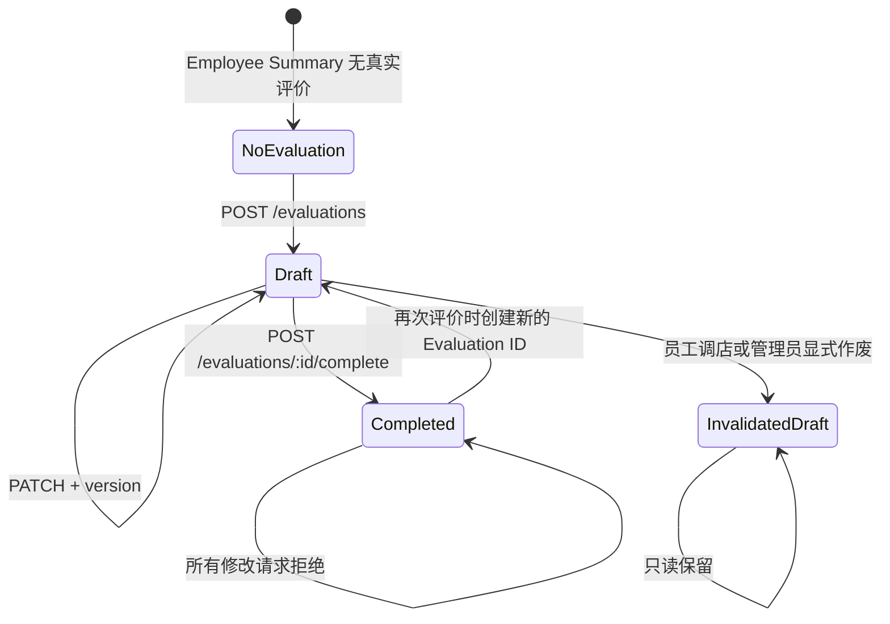

# 员工实时评价系统整改设计与 P0 修复计划

文档日期：2026-08-11  
依据：`EMPLOYEE_EVALUATION_AUDIT.md`、当前工作区代码、新确认的实时评价业务基线  
文档性质：产品语义校正、审计复核、目标设计和实施拆分  
本轮限制：仅分析和生成本文件，未修改业务代码、配置、Prisma schema、migration、依赖或数据库。

## 1. 产品语义校正摘要

### 1.1 权威领域语义

本项目是员工实时评价系统，不是周期评价系统。新的唯一权威语义如下：

- 不存在 Evaluation Period，也不存在季度、Active Period、Completed Period、Archived Period、周期切换或周期归档。
- 每次评价是独立的数据库记录，使用真实、稳定、不可伪造的 Evaluation ID。
- 持久化 Evaluation 只有 `Draft` 和 `Completed` 两种状态。
- `Draft -> Completed` 是唯一正式状态转换。
- `Completed` 永久不可编辑、不可 reopen、不可退回 Draft。再次评价必须创建新记录。
- `Not Evaluated` 是 Employee Evaluation Summary 的派生展示状态，不是 Evaluation 状态。
- 不创建 Synthetic Evaluation，不生成 `synthetic:*` ID，不把虚拟对象发送给写接口。
- 正式评分统计只使用 Completed。Draft 只用于工作流数量和待完成状态。
- Completed Evaluation 必须保存评价完成时的员工、门店、评价人和评分规则快照。

### 1.2 当前代码与新语义的主要差距

当前代码已尝试支持“随时评分”，但仍以旧周期字段模拟实时记录：

- `Evaluation.evaluationPeriod` 仍为必填，并参与唯一约束。
- `createInstantEvaluationLabel()` 把本地秒级时间写进 `evaluationPeriod`。
- `/evaluations/periods`、period query、季度 mock 和文档仍存在。
- `NotStarted`、`NeedsReview` 仍存在于 Prisma enum、前端类型、筛选器、seed、mock 和测试。
- 无评价员工被包装成 Synthetic Evaluation，使用伪造 ID。
- 首次保存或完成通过 employee/store/period 查找或创建，而不是明确创建真实 Draft。

这些不是“缺少周期功能”，而是旧周期语义未清理、实时评价模型尚未统一。

### 1.3 校正后的目标流程

```text
员工列表/门店页面
    -> GET Employee Evaluation Summary
       - latestCompletedEvaluation
       - activeDraft
       - completedEvaluationCount
       - evaluationDisplayStatus

点击“开始评价”
    -> POST /evaluations
    -> 创建真实 Draft，立即返回真实 evaluationId
    -> 导航到 /evaluations/:evaluationId

编辑草稿
    -> PATCH /evaluations/:evaluationId，携带 version

完成评价
    -> POST /evaluations/:evaluationId/complete，携带 version 和可选 aiRunId
    -> 服务端校验、重算、写快照、原子转为 Completed

再次评价
    -> 新建另一条 Draft，不修改旧 Completed
```

## 2. 23 项审计问题复核表

复核后有 22 个有效问题：Critical 2、High 11、Medium 8、Low 1。原 AUDIT-011 被合并进升级后的 AUDIT-012，不再单独计数。

| 原编号 | 原严重程度 | 复核结论 | 新严重程度 | 处理方式 | 原因 |
| --- | ----- | ---- | ----- | ---- | -- |
| AUDIT-001 | Critical | 保留 | Critical | P0-1 | 客户端仍可伪造身份、角色和门店范围，新业务语义不影响该安全事实 |
| AUDIT-002 | Critical | 保留 | Critical | P0-2 | 强制硬删除和 Cascade 仍可销毁全部实时评价历史 |
| AUDIT-003 | High | 保留 | High | P0-3 | 非空数据库/AI secret 位于未忽略的 `.env`，风险不变 |
| AUDIT-004 | High | 改写 | High | P0-8 | 改写为“旧周期制语义未彻底清理，实时评价模型尚未统一”；不要求 Period 模型，不把无 reopen 视为缺陷 |
| AUDIT-005 | High | 保留 | High | P0-7 | 调店后旧门店仍可能完成旧 Draft，违反新明确规则 |
| AUDIT-006 | High | 保留 | High | P0-7 | Completed 缺少不可变快照，违反历史事实不可变规则 |
| AUDIT-007 | High | 保留 | High | P0-4 | evaluatorId 和 AI 分仍由客户端声明，审计来源不可信 |
| AUDIT-008 | High | 保留 | High | P0-5 | 当前公式可产生负 finalScore，违反 0-100 不变量 |
| AUDIT-009 | High | 保留 | High | P0-6 | Draft 仍进入正式统计，直接违反新统计口径 |
| AUDIT-010 | High | 保留 | High | AI 治理 P0 安全项 | 外部 AI 的隐私、限流和数据保留风险不因模型校正而改变 |
| AUDIT-011 | Medium | 合并 | 合并至 AUDIT-012 | P0-8 | Synthetic 首次完成并发问题的根治方式是移除 Synthetic 写流程和建立真实 create endpoint |
| AUDIT-012 | Medium | 升级 | High | P0-8 | Synthetic 不再只是契约脆弱，而是与权威业务基线冲突的核心资源模型问题 |
| AUDIT-013 | Medium | 升级 | High | P0-6 | 全局平均分是核心正式 KPI，新规则明确禁止门店平均值再平均 |
| AUDIT-014 | Medium | 升级 | High | P0-6 | 门店 scope 必须在查询、排序和 limit 前生效，当前结果可实质漏报 |
| AUDIT-015 | Medium | 保留 | Medium | 性能整改 | 多次实时评价会加速历史增长，全量 latest/history 查询风险更明确 |
| AUDIT-016 | Medium | 保留 | Medium | 数据模型后续项 | Employee 缺少稳定业务唯一标识，影响跨店历史串联和防重 |
| AUDIT-017 | Medium | 保留 | Medium | API 契约整改 | 手写响应类型和无运行时校验仍会放大迁移期前后端漂移 |
| AUDIT-018 | Medium | 保留 | Medium | Fallback 整改 | 全局 fallback 布尔值、无 timeout、伪造计数的问题仍存在 |
| AUDIT-019 | Medium | 保留 | Medium | 平台整改 | 错误映射、request ID、Prisma 冲突映射和结构化日志仍不足 |
| AUDIT-020 | Medium | 保留 | Medium | 正式需求 | 简单数据导出仍是正式需求，但不属于本轮 P0 安全修复核心 |
| AUDIT-021 | Medium | 保留 | Medium | 测试与 CI | 真实 DB、并发、权限、迁移和 E2E 缺口仍存在 |
| AUDIT-022 | Medium | 保留 | Medium | UX 后续项 | 离页保护、label、触控目标和角色反馈问题仍成立 |
| AUDIT-023 | Low | 保留 | Low | 依赖维护 | 低危生产依赖 advisory 和 Prisma 配置弃用警告不变 |

### 2.1 明确移除的旧结论

- “缺少 Evaluation Period 模型”不是缺陷。
- “缺少 Active/Completed/Archived Period 状态机”不是缺陷。
- “没有 reopen”不是缺陷。
- “没有 Completed -> NeedsReview 转换”不是缺陷。
- 真正缺陷是 `evaluationPeriod`、`NeedsReview`、`NotStarted`、reopen 文档和 Synthetic 逻辑仍残留。

## 3. 新的实时评价领域模型

### 3.1 Evaluation 聚合

以下是目标概念模型，不是本轮 Prisma 修改。

| 字段 | Draft | Completed | 来源 | 完成后是否可改 | 说明 |
| --- | --- | --- | --- | --- | --- |
| `id` | 必须 | 必须 | 服务端/数据库 | 否 | UUID/CUID，创建 Draft 时立即产生 |
| `employeeId` | 必须 | 必须 | 客户端仅选择员工，服务端校验 | 否 | 指向稳定 Employee ID |
| `storeId` | 必须 | 必须 | 服务端从员工当前门店取得 | 否 | 不接受客户端任意指定；表示评价发生门店 |
| `evaluatorId` | 必须 | 必须 | 可信认证上下文 | 否 | 请求体不得提交 |
| `status` | `Draft` | `Completed` | 服务端命令 | 否 | 只允许 Draft -> Completed |
| 8 个 manual score | 可空，支持部分草稿 | 全部必须 | 客户端输入，服务端校验 | 否 | 整数 0-100 |
| `managerReview` | 可空 | 建议必须且非空 | 客户端输入 | 否 | 是否强制最小长度需产品确认 |
| `aiRunId` | 可空 | 可空 | 客户端选择 runId，服务端验证 | 否 | 纯人工完成时为空 |
| `aiOriginalTextScore` | 可空 | 按 aiRun 决定 | 服务端从成功 run 复制 | 否 | 客户端不能提交 |
| `aiOriginalRiskScore` | 可空 | 按 aiRun 决定 | 服务端从成功 run 复制 | 否 | 客户端不能提交 |
| `aiAppliedTextScore` | 可空 | AI 模式时必须 | 服务端或有审计的人工 override | 否 | 正式公式使用值 |
| `aiAppliedRiskScore` | 可空 | AI 模式时必须 | 服务端或有审计的人工 override | 否 | 正式公式使用值 |
| `manualWeightedScore` | 可空/预览值不持久化也可 | 必须 | 服务端计算 | 否 | 不能信任客户端 |
| `finalScore` | 可空 | 必须 | 服务端计算并 clamp | 否 | 0-100 |
| `riskLevel` | 可空 | 必须 | 服务端从正式风险规则计算 | 否 | 纯人工模式的规则需确认 |
| `grade` | 可空 | 必须 | 服务端计算 | 否 | 建议继续持久化历史值 |
| `scoringVersion` | 可空或创建时预置 | 必须 | 服务端配置 | 否 | 如 `realtime-v2` |
| `scoringMode` | 可空 | 必须 | 服务端判定 | 否 | 建议 `ManualOnly` / `ManualPlusAI` |
| `employeeNameSnapshot` | 可空 | 必须 | 完成事务读取 Employee | 否 | 历史展示只读快照 |
| `employeeRoleSnapshot` | 可空 | 必须 | 完成事务读取 Employee | 否 | 历史展示只读快照 |
| `storeNameSnapshot` | 可空 | 必须 | 完成事务读取 Store | 否 | 门店改名不影响旧历史 |
| `evaluatorNameSnapshot` | 可空 | 必须或明确 Unknown | 完成事务读取用户目录 | 否 | 暂无目录时可标记未知，不可伪造 |
| `createdAt` | 必须 | 必须 | 数据库 | 否 | Draft 创建时间 |
| `updatedAt` | 必须 | 必须 | 数据库 | Completed 后冻结 | Draft 最后保存时间 |
| `completedAt` | 必须为空 | 必须 | 数据库/服务端时钟 | 否 | 历史排序权威时间 |
| `version` | 必须 | 必须 | 数据库递增 | 否 | 乐观锁，防止静默覆盖 |
| `invalidatedAt` | 可空 | 必须为空 | 服务端调店事务 | 否 | 只用于已失效 Draft |
| `invalidatedReason` | 可空 | 必须为空 | 服务端 | 否 | 如 `EMPLOYEE_TRANSFERRED` |
| `invalidatedByUserId` | 可空 | 必须为空 | 可信认证上下文 | 否 | 保留调店处理审计 |

### 3.2 Draft 空值规则

Draft 是工作副本，可允许：

- manual score 部分为空。
- managerReview 为空。
- AI run 为空或失败。
- computed score、grade、riskLevel 为空；前端预览不代表正式持久化结果。
- completedAt 和全部完成快照为空。

不允许为空：id、employeeId、storeId、evaluatorId、status、createdAt、updatedAt、version。

### 3.3 Completed 不变量

Completed 时必须同时满足：

- status = Completed，completedAt 非空。
- 8 个 manual score 全部为整数 0-100。
- managerReview 满足最终产品约束。
- manualWeightedScore、finalScore、grade、riskLevel、scoringVersion、scoringMode 非空。
- finalScore 在 0-100。
- Employee、Store、Evaluator 快照完成；无法取得 evaluatorName 时使用明确的 `Unknown` 质量标识，不使用客户端文本。
- 如果 scoringMode = ManualPlusAI，则 aiRunId 指向该 Evaluation 的成功且可用 run，原始值和应用值均非空。
- 如果 scoringMode = ManualOnly，则所有正式 AI 应用字段为空，不能写默认 70/30 冒充 AI。

### 3.4 同一员工的 Draft 数量

建议：**每名员工最多一个可提交的 active Draft**。

原因：

- 避免多个经理同时开启不同草稿并互相覆盖或重复完成。
- Employee Evaluation Summary 可明确返回一个 `activeDraft`。
- 再次评价的语义是完成上一条后创建新 Draft。

数据库建议使用 PostgreSQL partial unique index：

```sql
UNIQUE (employeeId)
WHERE status = 'Draft' AND invalidatedAt IS NULL
```

Prisma schema 无法完整表达 partial index 时，应在 migration SQL 中显式创建，并在文档中登记。不要再使用 employee/store/period 唯一约束。

### 3.5 Check constraints 与索引

建议约束：

- 每个 manual score、AI score：NULL 或 0-100 整数。
- manualWeightedScore、finalScore：NULL 或 0-100。
- Draft: completedAt 必须 NULL。
- Completed: completedAt、全部必填分数、快照和 scoringVersion 必须非空。
- Completed: invalidatedAt 必须 NULL。
- invalidatedAt 非空时 status 必须 Draft。
- version >= 1。

建议索引：

- `(employeeId, status, completedAt DESC)`。
- `(storeId, status, completedAt DESC)`。
- `(status, completedAt DESC)`，用于全局正式统计。
- `(evaluatorId, createdAt DESC)`，用于审计。
- partial unique active Draft index。
- `AiAnalysisRun(evaluationId, status, createdAt DESC)`。

### 3.6 乐观锁

建议增加 `version Int @default(1)`。所有 Draft PATCH 与 complete 命令携带期望 version：

- `UPDATE ... WHERE id = ? AND status = 'Draft' AND version = ? AND invalidatedAt IS NULL`。
- 成功后 `version = version + 1`。
- 影响行数为 0 时重新读取，区分 404、409 stale version、409 Completed、409 invalidated。
- 重复 complete 使用幂等键或状态重读，不能返回 500。

## 4. Employee Evaluation Summary

### 4.1 只读 DTO

```ts
type EmployeeEvaluationSummary = {
  employee: {
    id: string;
    name: string;
    role: string;
    storeId: string;
    storeName: string;
    status: "Active" | "Archived";
  };
  latestCompletedEvaluation: null | {
    id: string;
    finalScore: number;
    grade: Grade;
    riskLevel: RiskLevel;
    completedAt: string;
    storeId: string;
    storeNameSnapshot: string;
  };
  activeDraft: null | {
    id: string;
    evaluatorId: string;
    updatedAt: string;
    version: number;
  };
  completedEvaluationCount: number;
  evaluationDisplayStatus:
    | "NotEvaluated"
    | "DraftInProgress"
    | "Evaluated"
    | "EvaluatedWithDraft";
  lastEvaluatedAt: string | null;
};
```

### 4.2 展示状态规则

- 无 Completed、无 active Draft：`NotEvaluated`。
- 无 Completed、有 active Draft：`DraftInProgress`。
- 有 Completed、无 active Draft：`Evaluated`。
- 有 Completed、有 active Draft：`EvaluatedWithDraft`。
- invalidated Draft 不作为 activeDraft，也不改变展示状态，但可在审计/管理视图查看。

### 4.3 如何取代 Synthetic Evaluation

- 门店页面遍历 Summary，而不是遍历伪 Evaluation。
- “尚未评价”来自 `latestCompletedEvaluation === null`，不创建数据库记录。
- “继续草稿”使用 `activeDraft.id` 打开真实资源。
- “开始评价”调用 `POST /evaluations`，成功后才获得 ID。
- fallback 返回 Summary mock，但不得为无评价员工生成 evaluationId。
- update/complete API 只接受数据库真实 ID，不接受 employee/store 组合兜底创建。

## 5. AI Analysis Run 设计

### 5.1 关联和状态

- AiAnalysisRun 必须通过真实 FK `evaluationId` 关联一个 Draft Evaluation。
- 允许状态：`Queued`、`Running`、`Succeeded`、`Failed`、`TimedOut`、`Rejected`。这里只是 AI run 状态，不是 Evaluation 状态。
- 只有 `Succeeded` 且输出通过结构校验、分数范围校验、evaluationId 匹配的 run 可用于正式评分。
- Completed 后不允许新增 run，也不允许更换关联 run。

建议保留：providerType、provider、model、promptVersion、inputHash、textReviewSnapshot、includedNotes、scores、structured result、latency、errorCode、createdAt、completedAt。

`providerType` 明确区分：

- `LocalRules`：本地确定性规则。
- `ExternalModel`：DeepSeek 或未来外部模型。

不要只依赖 provider 字符串推断来源。

### 5.2 防止客户端伪造 AI 分

1. 客户端调用 `POST /evaluations/:id/ai-analysis`，不提交正式 AI 分。
2. 后端读取 Draft 的 employee/store/review，创建 run 并调用 provider。
3. 后端验证 provider 输出并持久化不可变 run。
4. 客户端 complete 时只可提交 `aiRunId` 或明确选择 ManualOnly。
5. 后端按 evaluationId 查询 run，验证状态、归属、输出和权限，再复制正式应用值。
6. 请求体中的 `aiTextScore`、`aiRiskScore` 一律拒绝或忽略，不作为正式来源。

### 5.3 人工调整 AI 建议

原始 run 永不修改。若允许人工调整，建议使用独立审计实体 `EvaluationAiOverride`：

- evaluationId、aiRunId。
- originalAiTextScore、originalAiRiskScore。
- adjustedAiTextScore、adjustedAiRiskScore。
- reason，必填并限制长度。
- adjustedByUserId，来自认证上下文。
- adjustedAt。

完成事务读取最新合法 override，复制 original/applied 值到 Completed Evaluation 快照。需要产品负责人确认哪些角色可调整，建议仅 Admin/AreaManager，StoreManager 只能接受或改用 ManualOnly。

### 5.4 AI 不可用时

- 允许纯人工完成，不应使用默认 70/30 假装 AI 结果。
- scoringMode = ManualOnly。
- finalScore 使用该 scoringVersion 定义的纯人工公式，建议等于 manualWeightedScore。
- AI 面板显示“未使用 AI”，不是显示 0 分或默认分。
- Failed/TimedOut run 保留审计，但不进入评价分数。

## 6. 新的状态机



说明：

- `NoEvaluation` 是 Summary 派生状态，不是数据库 EvaluationStatus。
- `InvalidatedDraft` 是 `status=Draft + invalidatedAt != null` 的派生生命周期，不新增第三个 EvaluationStatus。
- Completed 到 Draft 的箭头表示创建新记录，不是旧记录状态回退。
- 不存在 reopen、NeedsReview、NotStarted 或周期状态。

## 7. 权限模型

### 7.1 Auth Provider 抽象

在尚未确定 SSO 提供方时，建立可替换接口：

```ts
interface AuthProvider {
  authenticate(request: Request): Promise<AuthenticatedIdentity>;
}

type AuthenticatedIdentity = {
  subject: string;
  issuer: string;
  assuranceLevel?: string;
};

interface AuthorizationService {
  resolvePrincipal(identity: AuthenticatedIdentity): Promise<AuthPrincipal>;
}

type AuthPrincipal = {
  userId: string;
  role: "Admin" | "AreaManager" | "StoreManager";
  storeIds: string[];
  active: boolean;
};
```

AuthProvider 只验证凭证并得到稳定 subject。AuthorizationService 再从服务端数据库/目录查询 userId、角色和门店。浏览器不得提供 role 或 storeIds。

### 7.2 开发与生产严格隔离

- 生产：启动时必须配置 ProductionAuthProvider；若配置为 DevAuthProvider，进程直接拒绝启动。
- 开发：仅在 `NODE_ENV=development` 且显式 `ALLOW_DEV_AUTH=true` 时启用。
- Dev 模式只允许选择服务端预置的 dev user ID，服务端仍查询其角色和门店；不得让浏览器提交任意 role/storeIds。
- Dev 模拟 endpoint 仅绑定 loopback，CORS 只允许本地前端，并显示显著 Dev banner。
- 测试：使用 TestAuthProvider 依赖注入，不通过生产 HTTP header 后门。
- 网关模式如未来采用受信 header，必须由网关清除外部同名头、使用 mTLS/私网，并由应用验证网关身份。

### 7.3 为什么不能继续信任浏览器头

浏览器、curl、代理和恶意脚本都能构造 `x-user-role` 和 `x-store-ids`。CORS 不是认证，前端隐藏按钮也不是授权。只有服务端验证的凭证和服务端存储的授权关系可以形成可信边界。

### 7.4 服务端权限矩阵

| 操作 | Admin | AreaManager | StoreManager |
| --- | --- | --- | --- |
| 查看 Dashboard/Analytics | 全部可见门店 | 被授权门店 | 被授权门店 |
| 查看员工/Summary | 全部 | 被授权门店 | 被授权门店 |
| 创建/编辑 Employee | 全部 | 被授权门店 | 建议仅被授权门店；是否允许调店需确认 |
| 调店 | 允许 | 源/目标均授权 | 默认禁止，建议升级审批 |
| 创建 Draft | Active 门店员工 | 授权 Active 门店员工 | 授权 Active 门店员工 |
| 编辑 Draft | 全部，仍受版本/归属约束 | 评价门店授权且员工未调店 | 评价门店授权且员工未调店 |
| 完成 Draft | 同上 | 同上 | 同上 |
| 修改 Completed | 禁止 | 禁止 | 禁止 |
| 查看历史 | 全部 | 评价发生门店在授权范围 | 评价发生门店在授权范围 |
| 运行 AI | 全部 Draft | 授权 Draft | 授权 Draft |
| AI override | 建议允许 | 建议允许 | 建议禁止，仅接受或 ManualOnly |
| 归档/恢复 Store | 允许 | 禁止 | 禁止 |
| 硬删除 Store | 禁止 | 禁止 | 禁止 |
| 导出 | 全部 scope | 授权 scope | 授权门店，字段可收窄 |

### 7.5 统一中间件和策略

- 除 `/health` 外，API router 顶层统一 `authenticate`。
- `resolvePrincipal` 检查用户 active 状态。
- 路由不自行解析身份头。
- resource loader 先在授权 scope 内查询资源。未授权和不存在统一返回 404，减少资源存在性泄露；明确角色禁止可返回 403。
- command service 再执行领域不变量校验，形成 defense in depth。
- 所有写操作记录 userId、storeId、resourceId、requestId 和结果，不记录 secret 或完整敏感文本。

## 8. P0 修复设计

### P0-1：可信身份认证与权限

实施设计：

1. 定义 AuthProvider、AuthorizationService、AuthPrincipal，不绑定具体第三方。
2. Express 顶层中间件认证并把只读 principal 放入 request context。
3. 服务端用户/角色/门店授权必须来自数据库或可信目录。
4. 替换 `getAuthContext` 的 header 解析；移除生产路径的无头部 Dev Admin。
5. 路由使用声明式 policy，例如 `requireRole`、`requireStoreScope`、`loadEvaluationInScope`。
6. 前端只读取 `/me` 返回的显示权限，用于 UX；后端始终独立授权。
7. Auth Provider 未选定前，可使用依赖注入的 Stub/Dev provider 开发，但生产启动保护必须先落地。

验收关键：伪造 role/store headers 对权限没有任何影响；无认证全部 401；跨门店资源按策略 404/403。

### P0-2：禁止门店硬删除和历史级联删除

目标 Store 生命周期：

- `status: Active | Archived`。
- `archivedAt`、`archivedByUserId`、可选 `archiveReason`。
- 归档门店禁止新员工、调入、Draft、AI run、PerformanceNote 和评价完成。
- 历史查询继续包含 Archived Store，并显示 Archived badge。
- 恢复 Store 仅 Admin 可执行，恢复不自动恢复员工或 invalidated Draft。

API 计划：

- 新增 `POST /stores/:storeId/archive` 和可选 `POST /stores/:storeId/restore`。
- `DELETE /stores/:storeId` 最终移除或永久返回 405。
- 移除 `?force=1`、前端 Force Delete 和所有硬删除文案。

FK 策略：

- Employee -> Store：`Restrict/NoAction`。
- Evaluation -> Employee/Store：`Restrict/NoAction`。
- PerformanceNote -> Employee/Store：`Restrict/NoAction`。
- AiAnalysisRun -> Employee/Store/Evaluation：`Restrict/NoAction`。
- EvaluationActivity -> Employee/Store/Evaluation：`Restrict/NoAction`。

现有数据迁移只新增状态并把所有 Store 回填 Active，再替换 FK action。替换 FK 不删除任何行。迁移前做 orphan 检查；若发现 orphan，停止而不是自动删除。

### P0-3：Secret 管理

必须轮换：

- 当前 DeepSeek API key。
- 当前 PostgreSQL 用户密码/连接凭据。
- 若同一凭据用于 Docker、测试或其他环境，分别拆分并全部轮换。
- 检查是否还有部署 token、CI token、备份凭据；本轮未发现具体类型时不猜测值。

`.gitignore` 建议：

```gitignore
.env
.env.*
!.env.example
!**/.env.example
backend/.env
```

`.env.example` 只保留键名和安全占位：

- 前端：`VITE_API_BASE_URL`。
- 后端：`DATABASE_URL`、`PORT`、`CORS_ORIGIN`、`AI_ANALYSIS_PROVIDER`、`DEEPSEEK_API_KEY`、`DEEPSEEK_BASE_URL`、`DEEPSEEK_MODEL`、timeout/retry 配置、未来 auth provider 配置名。
- secret 值必须为空或使用 `replace-me`，不得放可用凭据。

Git 历史检查：

- 在真实仓库执行 secret scanner 和 `git log -p --all -- .env backend/.env`。
- 检查远端分支、tag、fork、CI artifact、容器镜像层和备份。
- 即使从历史删除，也必须轮换，因为历史副本不可保证全部消失。

环境注入：

- 开发：本机 `.env`，明确忽略，使用最小权限 dev 凭据。
- 测试：测试 runner 临时环境或 CI secret，独立测试 DB 和无外部 AI 默认配置。
- 生产：平台 secret manager/编排器 secret 注入，不烘焙进镜像，不落日志。

日志和错误响应：

- 不记录 Authorization、DATABASE_URL、provider request headers、完整 provider error body。
- 全局错误 handler 不直接返回未知 Error.message。
- 对连接错误只返回稳定 error code 和 requestId。

### P0-4：可信评价人和 AI 分来源

- create Draft 时 evaluatorId = principal.userId。
- draft/complete request schema 移除 evaluatorId、aiTextScore、aiRiskScore。
- AI 分析只能在真实 Draft ID 下创建 run。
- complete 接收 `version`、可选 `aiRunId`、可选 `scoringMode`，不接收 AI 数值。
- 后端读取属于同 Evaluation 的 Succeeded run，并复制原始分。
- AI override 使用独立不可变审计记录；complete 复制应用值和 override 元数据。
- AI 失败、超时或用户拒绝 AI 时允许 ManualOnly 完成。
- LocalRules 与 ExternalModel 通过 providerType、provider、model、promptVersion 明确区分。

### P0-5：评分不变量

输入规则：

- 8 个 manual score 在 Draft 可空，在 Completed 必须为整数 0-100。
- AI 原始/应用分若存在必须为整数 0-100。
- 不接受 NaN、Infinity、小数字符串或越界值。
- 未评分字段是 NULL，不是 0；0 只表示经理明确给出 0。

唯一权威：

- 后端 scoring domain 是唯一正式计算来源。
- 前端只做非权威预览。
- 完成时忽略客户端 computed fields并全部重算。

建议 `realtime-v2` 规则：

- manualWeightedScore = 各 manual score 按权重加权，权重和必须为 1。
- ManualOnly：finalScore = manualWeightedScore。
- ManualPlusAI：沿用或调整现有公式前必须由产品确认；无论公式如何，最后执行 `clamp(0, 100)`。
- 使用 Decimal 或整数基点计算，最终统一 `ROUND_HALF_UP` 到 1 位小数。
- grade、riskLevel 同一事务内基于最终持久化值计算。
- Completed 保存 scoringVersion 和 scoringMode，历史永不重算。

数据库约束：为输入和输出增加 CHECK，并增加 Completed 条件完整性约束。应用校验提供友好 400，DB 约束作为最后防线。

前端同步：由后端返回 scoring policy/version 和预览 endpoint，或从共享纯函数包生成；complete 响应始终以服务端结果覆盖前端预览。

### P0-6：正式统计口径

建议区分两个明确数据集：

1. `LatestCompletedPerEmployee`：运营 Dashboard 默认使用，每名员工最多贡献一条最新 Completed。
2. `CompletedHistory`：历史趋势和指定时间范围分析使用全部 Completed。

默认 Dashboard：

- totalEmployees：scope 内 Active 员工数。
- notEvaluatedEmployees：找不到 Completed 的 Active 员工数。
- activeDrafts：未 invalidated Draft 数。
- completedEmployees：拥有至少一条 Completed 的 Active 员工数。
- averageFinalScore：对 `LatestCompletedPerEmployee.finalScore` 直接 AVG，每名员工一票。
- risk distribution、needs attention、top performers、dimension weaknesses：全部基于 LatestCompletedPerEmployee。

不要先算各门店平均再平均。全局平均应直接对选定记录集求和/计数。

Scope 顺序：

```text
principal store scope
 -> 可选 store filter
 -> status = Completed
 -> 每员工 latest 窗口/子查询
 -> 聚合/排序
 -> limit/cursor
```

门店筛选必须同时影响：KPI、needs attention、recent activity、risk distribution、top performers、weakness analysis 和 Draft workflow counts。Recent activity 若展示 Draft 活动，应单独标明，不混入正式绩效分。

查询建议：PostgreSQL `ROW_NUMBER() OVER (PARTITION BY employeeId ORDER BY completedAt DESC, id DESC)` 或 `DISTINCT ON (employeeId)`。500 名员工、每人多次评价时，查询复杂度由合适索引支持，数据库处理约 O(R log R)，返回 O(E)，其中 R 是 scope 内 Completed 数，E 是员工数。不要把全部历史读入 Node 后 Map 去重。

索引：

- `(storeId, status, employeeId, completedAt DESC)`。
- `(employeeId, status, completedAt DESC)`。
- `(status, completedAt DESC)`。
- Draft workflow：partial index `(storeId, updatedAt DESC) WHERE status='Draft' AND invalidatedAt IS NULL`。

### P0-7：不可变历史和员工调店

完成事务边界：

1. 按 id、status=Draft、version、invalidatedAt=NULL 读取 Draft。
2. 锁定/校验 Employee 当前 storeId 仍等于 Draft.storeId，Employee 和 Store 均 Active。
3. 从可信目录读取 evaluator；校验操作者仍有 Draft.storeId 权限。
4. 读取/验证 AI run 或 ManualOnly 选择。
5. 验证 manual fields，计算分数。
6. 写入 employee/store/evaluator 快照、scoringVersion、completedAt，并原子更新 status=Completed、version+1。
7. 写不可变审计活动。

Completed 不可修改：

- PATCH service 只匹配 status=Draft。
- complete 重复调用返回幂等成功或 409，不能重写 completedAt。
- 普通 API 不提供 Completed update。
- 建议数据库 trigger 阻止 Completed row UPDATE/DELETE，或至少用受限 DB role 和审计 trigger 提供最后防线。是否引入 trigger需团队确认运维接受度。

员工调店最简单安全方案：

- 调店命令在同一事务中锁定 Employee。
- 找到旧门店 active Draft，设置 `invalidatedAt`、`invalidatedReason=EMPLOYEE_TRANSFERRED`、`invalidatedByUserId`。
- 不删除 Draft，不把它转 Completed，不复制到新门店。
- invalidated Draft 永久只读，不进入 activeDraft、统计或正式历史；管理审计页可查看。
- 更新 Employee.storeId。
- 新门店需要评价时调用 create endpoint 创建新的真实 Draft。
- 不新增第三个 EvaluationStatus；失效通过 metadata 派生。

历史查询：

- Employee 全局历史按 employeeId + completedAt 串联，跨门店显示完整时间线。
- 每条记录显示自身 storeNameSnapshot 和 role/name snapshot。
- 门店历史按 Evaluation.storeId 查询，旧记录永久留在原店。
- 用户只能看到其当前授权门店范围内的历史；Admin 可看员工完整跨店时间线。跨店全局时间线对 AreaManager 的可见规则需确认。

### P0-8：实时评价模型统一

需要清理或替换：

| 层 | 清理/替换内容 |
| --- | --- |
| Prisma | 移除 `evaluationPeriod`；EvaluationStatus 只保留 Draft/Completed；AiAnalysisRun 移除 period 并增加 Evaluation FK；移除 period 索引和复合 unique；增加快照、version、scoringVersion、invalidated metadata |
| API | 移除 `/evaluations/periods`、period query、`new=1` synthetic form；新增真实 create、summary、id-based draft/complete/history API |
| Backend service | 删除 listPeriods、createInstantEvaluationLabel、toSyntheticEvaluation、period upsert/find；创建明确 command/query service |
| Frontend repository | 删除 fetchPeriods、period 参数、synthetic fallback；新增 createEvaluation、fetchSummary、fetchEvaluationById、patchDraft |
| TypeScript | EvaluationStatus 只含 Draft/Completed；删除 Evaluation.evaluationPeriod；新增 Summary DTO、Invalidated Draft 管理 DTO |
| Mock/fallback | 删除季度数组和按 period 聚合；无评价员工只返回 Summary 状态，不创建 fake Evaluation ID |
| 页面筛选 | Store 页面状态筛选改为 Not Evaluated/Draft/Evaluated 这一 Summary 展示筛选；History 使用时间范围而非 period |
| 测试 | 删除 reopen/NeedsReview/NotStarted/period/synthetic 预期；增加真实 ID、Summary、重复评价、并发和迁移测试 |
| 文档 | 重写 evaluation API contract、performance note 对比、AI analysis 示例、README；明确实时记录和不可变历史 |
| UI 文案 | 移除 period、quarter、reopen、Needs Review、Not Started Evaluation；使用 Not Evaluated、Start Evaluation、Resume Draft、Completed at |

## 9. 数据库迁移方案

必须采用 Expand -> Backfill -> Dual-read/有限 Dual-write -> Contract，不能一次破坏性迁移。

### Phase 0：盘点与保护

- 对目标数据库做可恢复备份并验证 restore。
- 只读统计各 EvaluationStatus 数量、evaluationPeriod 格式、重复员工 active Draft 候选、NULL/越界分、orphan FK。
- 记录 NeedsReview/NotStarted 中是否存在 completedAt、文本或有意义分数。
- 冻结旧 schema 的非必要变更。
- 为每次 backfill 建 migration run ID、行数校验和异常清单。

### Phase 1：Expand

新增但暂不删除旧字段：

- Store status/archive metadata。
- Evaluation 新状态列，例如 `recordStatus`，仅 Draft/Completed；快照、scoringVersion、scoringMode、version、invalidated metadata、AI original/applied 字段。
- AiAnalysisRun evaluation FK 和 providerType/promptVersion 等可空字段。
- 新索引先 CONCURRENTLY 创建（由部署流程单独执行，避免长锁）。
- FK delete action 从 Cascade 迁到 Restrict/NoAction，先做 orphan 检查。

旧 `evaluationStatus`、`evaluationPeriod` 和旧 unique 暂时保留，保证旧后端还能运行。

### Phase 2：Backfill

状态转换：

| 旧状态 | 新 recordStatus | 处理 |
| --- | --- | --- |
| Draft | Draft | 保留；若员工已调店则 invalidatedReason=`LEGACY_STORE_MISMATCH` |
| Completed | Completed | 保留 completedAt；回填快照和 scoringVersion |
| NeedsReview + completedAt 非空 | Completed | 视为曾完成记录，永久冻结；不恢复 reopen |
| NeedsReview + completedAt 为空 | Draft + invalidated | 标记 `LEGACY_NEEDS_REVIEW_UNRESOLVED`，人工检查，不允许提交 |
| NotStarted | Draft + invalidated | 标记 `LEGACY_NOT_STARTED_PLACEHOLDER`，不进入 Summary activeDraft/统计；后续 contract 前经备份和审批清理 |

`evaluationPeriod` 数据：

- 在过渡期只作为 `legacyEvaluationPeriod` 读取，不再用于业务排序、唯一性或 API。
- 历史排序使用 completedAt，Draft 使用 createdAt/updatedAt。
- Contract 阶段删除字段前导出映射审计表，不把季度/Instant 字符串迁成新业务字段。

快照回填：

- employeeNameSnapshot/roleSnapshot 从当前 Employee 回填。
- storeNameSnapshot 从当前 Store 回填。
- evaluatorNameSnapshot 从可信用户目录回填；无匹配则 `Unknown`。
- 增加 `snapshotQuality`：`ExactAtCompletion`、`BackfilledCurrentValue`、`Unknown`。
- 所有旧数据回填应标记 `BackfilledCurrentValue` 或 Unknown，不能声称是完成时精确值。

scoringVersion：

- 若存储分数与当前旧公式在容差内一致，标记 `legacy-v1-inferred`。
- 不一致或字段不足标记 `legacy-unknown`。
- 绝不重算/覆盖旧 finalScore。

AI run 关联：

- 只有 employeeId/storeId/legacyPeriod 能唯一匹配一条 Evaluation 时自动关联。
- 模糊匹配留空并记录 `linkStatus=Ambiguous`，不得猜测。

### Phase 3：兼容发布

- 新后端优先读新字段，缺失时使用兼容 adapter。
- 新 create endpoint 立即创建真实 Draft ID，同时为了旧 schema 约束临时写 `evaluationPeriod = legacy:<evaluationId>`。
- 旧 endpoint 暂时只读或返回 deprecation header；旧 synthetic complete 可在短过渡期映射为 create + complete，但必须幂等并记录 legacy client，建议尽快关闭。
- 新前端只使用 Summary 和真实 ID，不再生成 synthetic。
- 不建议长期 dual-write两套业务逻辑；仅为旧非空列和兼容窗口写 legacy 占位。

### Phase 4：强约束

- 验证所有 Completed 新字段非空、score 合法、status 映射完成。
- 建 partial unique active Draft。
- 加 CHECK、Restrict FK 和 Completed immutable 保护。
- 关闭 period/reopen/synthetic legacy endpoints。

### Phase 5：Contract

在至少一个稳定发布周期后：

- 删除旧 `evaluationPeriod`、旧 period 索引和复合 unique。
- 删除旧 EvaluationStatus enum/column，正式使用 Draft/Completed enum。
- 删除 AiAnalysisRun period 字段。
- 删除旧 DTO、mock、测试和文档。
- 删除兼容 adapter。

### 迁移失败与回滚

- Expand 可回滚应用，不回滚已添加的可空列；旧应用继续使用旧字段。
- Backfill 必须幂等、分批、可断点续跑；每批记录 before/after checksum 和异常表。
- 任何约束启用前先运行验证查询；失败则停止，不自动修正或删除。
- Contract 前保留完整备份、旧字段导出和至少一个发布周期观察。
- 一旦删除旧字段/enum，数据库回滚成本高，应采用 roll-forward；真正删除前设置人工批准门。
- 前后端版本不一致时：新后端兼容旧前端一个短窗口；新前端必须要求支持 Summary API 的后端版本，可通过 `/api/capabilities` 判断。

## 10. API 变更清单

### 新增

| API | 用途 | 关键规则 |
| --- | --- | --- |
| `GET /api/me` | 当前可信用户和 UI 权限 | 不接受客户端角色覆盖 |
| `GET /api/stores/:storeId/employee-evaluation-summaries` | 门店员工评价摘要 | 服务端 scope、分页、搜索、展示状态筛选 |
| `POST /api/evaluations` | 创建真实 Draft | body 仅 employeeId；store/evaluator 服务端确定；返回真实 ID |
| `GET /api/evaluations/:evaluationId` | 读取真实 Draft/Completed | scope 内资源加载；Completed 返回快照 |
| `PATCH /api/evaluations/:evaluationId` | 保存 Draft | body 含 version、manual fields、review；只允许 Draft |
| `POST /api/evaluations/:evaluationId/complete` | 原子完成 | version、scoringMode、可选 aiRunId；服务端重算和快照 |
| `POST /api/evaluations/:evaluationId/ai-analysis` | 创建 AI run | 只允许有效 Draft，限流和 provider policy |
| `POST /api/evaluations/:evaluationId/ai-overrides` | 有审计的 AI 调整 | 限定角色，保存原值/新值/原因 |
| `GET /api/employees/:employeeId/evaluations` | 时间戳历史 | 仅 Completed，cursor + completedAt 排序，可按授权门店过滤 |
| `POST /api/stores/:storeId/archive` | 归档门店 | Admin only，禁止新写入但保留历史 |
| `POST /api/stores/:storeId/restore` | 恢复门店 | Admin only，不自动恢复 invalidated Draft |

### 修改

- Dashboard/Analytics API 使用 Completed-only 数据集，并让 storeId 在 SQL scope 最前生效。
- employee update/transfer 改为显式 command，事务内 invalidates active Draft。
- History DTO 使用 snapshot，不 join 当前姓名/角色覆盖历史。
- Error response 统一 `{ code, message, requestId, fieldErrors? }`。
- 所有写 API 使用 trusted principal，移除 evaluatorId 和正式 AI 数值输入。

### 移除

- `GET /api/evaluations/periods`。
- 所有 `period` query/body 字段。
- `GET /api/evaluations/form?...&new=1` synthetic 语义。
- synthetic/stale ID 自动 create 的 complete 行为。
- reopen 文档、stub 和任何 endpoint。
- NeedsReview/NotStarted Evaluation filter。
- `DELETE /api/stores/:id?force=1`。

## 11. 前端变更清单

- App 启动读取 `/me`，Dev role/store 编辑器只在明确本地开发构建显示。
- Store/Employee 页面改用 EmployeeEvaluationSummary。
- 状态筛选改为 Summary 展示状态：Not Evaluated、Draft In Progress、Evaluated、Evaluated With Draft。
- Score Now 先 POST create，成功后导航真实 ID；若 activeDraft 存在，显示 Resume Draft。
- Evaluation Form 路由改为 `/evaluations/:evaluationId`，不带 employee/store/period/new query。
- payload 移除 evaluatorId、AI 数值、evaluationPeriod、computed fields。
- 保存 Draft 携带 version，409 时显示冲突并提供重新加载，不静默覆盖。
- Completed 页面完全只读；再次评价按钮创建新 Draft。
- History 按 completedAt 展示 snapshot 和 scoringVersion，不展示 period。
- AI 面板显示 run providerType、模型、状态；失败允许 ManualOnly；override 明确显示原值、调整值、操作者和理由。
- Dashboard/Analytics 不再前端重算全局平均，不在 limit 后做门店过滤。
- fallback mock 改为 Summary；无评价员工没有 evaluationId；fallback 下所有 create/PATCH/complete/archive 继续禁止。
- 移除季度 mock、period selector、Needs Review/Not Started Evaluation badge 和失效文案。
- 保留并补强 loading/error/empty、dirty guard、冲突态和权限禁用说明。

## 12. 测试与验收标准

| 测试 | 层级 | 前置数据 | 操作 | 预期结果 | 对应风险 |
| --- | --- | --- | --- | --- | --- |
| 伪造 Admin | API 安全集成 | StoreManager 仅 store-A | 发送 `x-user-role=Admin`、store-B 头 | 头被忽略；store-B 404/403；审计记录真实 userId | P0-1 / AUDIT-001 |
| 未认证访问 | API 集成 | 无凭证 | 调全部非 health API | 统一 401，无 dev-admin fallback | P0-1 |
| 跨店读写 | API + DB | 用户仅 A，资源在 B | GET/PATCH/complete/AI/export | 不泄露资源；无数据库变化 | P0-1/P0-7 |
| Dev/Prod 隔离 | 启动配置测试 | NODE_ENV=production + Dev provider | 启动服务 | 启动失败并给非敏感配置错误 | P0-1 |
| 门店归档保留历史 | DB 集成 | Store 含员工、Completed、notes、runs | archive Store 后查历史和 FK 行数 | 历史仍在；新写入 409；无 delete | P0-2 |
| 硬删除禁止 | API + DB | 已归档 Store | 调 DELETE 和直接受限 service | API 405/404；FK Restrict；数据不变 | P0-2 |
| Completed 不可修改 | API + DB | Completed eval | PATCH、再次 complete、override、run AI | PATCH/AI 拒绝；completedAt/快照/version 不变 | P0-7 |
| Draft -> Completed | DB 集成 | 完整 Draft v1 | complete v1 | 单事务写分数、快照、scoringVersion；status Completed | P0-5/P0-7 |
| Completed 后再次评价 | API + DB | 员工已有 Completed | POST /evaluations | 创建新 Draft 新 ID；旧记录不变 | P0-8 |
| 同一 Draft 并发保存 | 并发 DB 集成 | Draft version 1 | 两个 PATCH version 1 | 一个成功到 v2，一个 409；不静默覆盖 | 并发完整性 |
| 同一 Draft 重复完成 | 并发 DB 集成 | Draft v1 + idempotency key | 并发 complete | 一条 Completed；相同 key 返回同结果；无 500 | 原 AUDIT-011 |
| Active Draft 唯一 | DB 约束测试 | 员工已有 active Draft | 再次 create | 返回现有 draft 或 409；数据库仅一条 active Draft | P0-8 |
| 最终分最小边界 | scoring property test | manual=0、AI 风险最大 | compute/complete | finalScore=0，不为负 | AUDIT-008 |
| 最终分最大边界 | scoring property test | 所有正向输入最大、风险最小 | compute/complete | finalScore <=100，舍入一致 | AUDIT-008 |
| NULL 与明确 0 | API + DB | 部分 Draft | 空字段保存，再用 0 完成 | NULL 保持未评分；0 被保留；缺字段不能 complete | P0-5 |
| Draft 不进 Analytics | DB API 集成 | 同店一 Draft、一 Completed | 查 Dashboard/Analytics | 正式平均/Top/risk 只含 Completed；Draft 只计 workflow | AUDIT-009 |
| 全局加权平均 | DB API 集成 | A 店 1人100，B 店9人50 | 查全局 KPI | AVG=(100+9*50)/10=55，不是 75 | AUDIT-013 |
| 门店筛选在 limit 前 | DB API 集成 | A/B 各多条风险记录，A 不在全局前 N | filter A needs attention | 返回 A 自身排序前 N，不受 B 截断影响 | AUDIT-014 |
| latest Completed 不取 Draft | DB API 集成 | 旧 Completed + 更新的 Draft | 查 Summary/Dashboard | latestCompleted 仍是 Completed；activeDraft 单列 | P0-6 |
| 历史快照不可变 | DB 集成 | 完成评价后有快照 | 改名、改角色、改店、改 Store 名 | 旧历史姓名/角色/门店名和分数不变 | AUDIT-006 |
| 调店使旧 Draft 失效 | DB 事务集成 | A 店 active Draft | 调到 B | Draft invalidated；Employee 到 B；无删除 | AUDIT-005 |
| 旧店不能完成 Draft | API + DB | 上述 invalidated Draft | A 店经理 complete | 409 invalidated；无状态/分数变化 | AUDIT-005 |
| 新店创建新评价 | API + DB | 员工已到 B、旧 Draft invalidated | B 店 create | 新真实 Draft storeId=B；旧 Draft保留 | P0-7 |
| AI run ID 伪造 | API + DB | eval-A、run 属于 eval-B | complete eval-A with run-B | 400/409；不复制 AI 分 | AUDIT-007 |
| 客户端直接 AI 分 | API contract | 合法 Draft | body 填 aiTextScore/aiRiskScore | schema 拒绝未知字段或忽略且不持久化 | AUDIT-007 |
| AI 失败/超时 | service + API | provider 500/timeout | run AI 后 ManualOnly complete | run Failed/TimedOut；可人工完成；AI 字段为空 | P0-4/P0-10 |
| AI override 审计 | DB 集成 | 成功 run | 授权用户调整并完成 | 原值不变；新值、原因、用户、时间完整 | P0-4 |
| Not Evaluated 无假记录 | API + DB | 员工无 Evaluation | 查询 Summary，多次刷新 | status NotEvaluated；evaluations 表行数不变；无 ID | P0-8 |
| 旧数据迁移可见 | migration 集成 | 各旧 status/period fixture | 执行 expand/backfill | Completed 可见且分不变；模糊快照有质量标记 | migration |
| FK 改 Restrict 无丢失 | migration 集成 | 全关系 fixture | 迁移后尝试删除 Store/Employee | 删除失败；迁移前后行数/checksum 一致 | P0-2 |
| 前后端兼容窗口 | contract/E2E | old/new 客户端与兼容后端 | 分别读写允许流程 | 兼容窗口内可运行；legacy 使用有日志；无 synthetic 新数据 | migration |

P0 验收总门槛：

- 所有上述 P0 测试进入 CI gate。
- 使用隔离 PostgreSQL，不复用开发数据库。
- migration 测试必须验证前后行数、关键 checksum 和失败回滚。
- 安全测试不能只 mock service，必须穿过真实 Express middleware 和真实授权查询。

## 13. 分阶段实施顺序

1. 产品负责人确认第 15 节决策，形成 ADR。
2. 建立 P0 安全/并发/迁移测试基础和隔离 DB。
3. 实现 AuthProvider 边界和服务端授权，先堵住身份伪造。
4. 完成 secret hygiene 和实际轮换，由人工在部署环境执行。
5. Expand Store 生命周期字段和 Restrict FK migration，暂不删旧 API。
6. 实现 Store archive/restore，移除 UI 强制删除入口，硬删除 API 进入兼容拒绝阶段。
7. Expand Evaluation/AI 新字段、状态列、version 和索引，保留旧字段。
8. 实现新实时 create/PATCH/complete/Summary API、可信 evaluator、AI run 和评分不变量。
9. 实现 Completed-only Dashboard/Analytics 查询。
10. 前端切换 Summary、真实 ID 和时间戳历史；停止创建任何 synthetic。
11. 执行可重入 backfill，核对异常和快照质量。
12. 启用强约束、active Draft partial unique、Completed immutability。
13. 观察一个稳定发布周期，确认无旧客户端调用。
14. Contract migration 删除 period、旧 enum、旧索引、legacy adapter 和失效文档。
15. 后续实现数据导出、fallback 细化、性能分页、UX 和依赖维护。

## 14. 风险和回滚方案

| 风险 | 控制 | 回滚/恢复 |
| --- | --- | --- |
| 认证切换导致全部用户 401 | capability flag、灰度环境、Test/Dev provider 隔离 | 回滚应用到兼容认证层，但绝不恢复公开可伪造角色头；使用受控网关临时认证 |
| FK 变更长时间锁表 | 低峰执行、先 orphan 检查、分约束操作 | 取消 migration；旧 FK 尚在时不删除 |
| status backfill 误分类 | dry-run 报告、异常队列、snapshotQuality | 回滚到备份/按 run ID 恢复新列；旧列仍保留 |
| NeedsReview/NotStarted 数据含真实工作 | 不自动删除；映射 invalidated 并人工审查 | 从旧列和备份恢复展示 |
| 新旧前端不兼容 | capabilities endpoint、短期 adapter、部署顺序后端先 | 回滚前端；新后端继续兼容旧读路径 |
| active Draft unique 创建失败 | 先列出重复候选，人工/规则 invalidation | 不创建索引，保持 expand 状态，不删除记录 |
| 快照无法准确回填 | snapshotQuality 标记，不伪造精确性 | 保留 Unknown/Backfilled 标识和旧关联读取 |
| 新公式改变旧历史 | scoringVersion，旧 finalScore 永不重算 | 回滚新应用；历史值不变 |
| AI provider 故障 | ManualOnly、timeout、限流、circuit breaker | 禁用外部 provider，继续人工流程 |
| Contract 后无法快速数据库降级 | 长观察期、备份、字段导出、人工批准 | 优先 roll-forward；必要时恢复整库到已验证备份 |

## 15. 仍需产品负责人确认的问题

1. 是否确认每名员工最多一个可提交 active Draft？本计划建议“是”。
2. Completed 前 managerReview 是否强制非空，是否需要最小长度？
3. AI 不可用时，ManualOnly 的 finalScore 是否直接等于 manualWeightedScore？
4. ManualPlusAI 是否沿用现有 75% manual + 20% AI text - 5% AI risk 公式，还是重新定权重？
5. StoreManager 是否允许员工调店，还是仅 AreaManager/Admin 可执行？本计划建议 StoreManager 禁止。
6. 哪些角色可人工 override AI 建议？本计划建议 Admin/AreaManager。
7. Dashboard 默认是否按“每名 Active 员工最新 Completed”统计？本计划建议是；历史 Analytics 再支持时间范围全部 Completed。
8. Archived Employee 是否继续进入历史 Analytics，默认 Dashboard 是否排除？本计划建议 Dashboard 排除、历史查询保留。
9. AreaManager 查看跨店员工完整时间线时，若员工曾在未授权门店工作，应隐藏该门店记录还是只做字段脱敏？本计划建议严格隐藏未授权记录。
10. invalidated Draft 的保留期限和可见角色是什么？本计划建议长期保留审计，普通 StoreManager 只看到“已失效”，Admin 可看详情。
11. 历史快照无法准确回填时，UI 是否接受“根据迁移时当前资料回填”的明确标识？
12. 是否接受 PostgreSQL trigger 作为 Completed 不可变性的数据库最后防线？
13. Store archive 是否允许恢复，以及恢复审批人和审计要求。
14. 正式数据导出的角色、字段范围、格式、时区和敏感字段脱敏规则。

## 16. Coding Agent 实施任务拆分

### TASK-001：冻结实时评价领域 ADR 与契约测试清单

* 目标：把本文件第 1、3、4、6、15 节确认结果写成可测试 ADR 和 API contract，不改数据库。
* 涉及文件或模块：`docs/`、测试计划文档、API contract 草案。
* 前置依赖：需要产品负责人先确认第 15 节第 1-9 项。
* 允许修改范围：文档、纯测试 fixture 设计。
* 禁止修改范围：业务代码、schema、migration、依赖、生产配置。
* 验收标准：明确 Draft/Completed、active Draft 唯一、ManualOnly/AI 公式、调店和统计口径；无 Period/reopen/NeedsReview。
* 必须运行的测试：文档链接/格式检查（若项目有）；无需业务测试。
* 回滚点：单独文档提交，可整体回滚。
* 预计复杂度：S

### TASK-002：建立 P0 API 安全与真实 PostgreSQL 测试骨架

* 目标：先建立失败测试，覆盖身份伪造、跨店、并发 Draft/complete 和 migration fixture。
* 涉及文件或模块：`backend/tests`、测试 DB 配置、CI 测试脚本。
* 前置依赖：TASK-001。
* 允许修改范围：测试、测试配置、CI；可增加测试辅助代码。
* 禁止修改范围：生产业务行为、生产 schema、真实数据库。
* 验收标准：关键测试在当前不安全实现上按预期失败；测试 DB 每次隔离并自动清理。
* 必须运行的测试：现有 81 后端测试、43 前端测试、新增 security/concurrency test suite。
* 回滚点：测试基础单独提交，不影响生产运行。
* 预计复杂度：M

### TASK-003：实现可替换 AuthProvider 与可信授权中间件

* 目标：移除生产对浏览器 role/store headers 和无头 Dev Admin 的信任。
* 涉及文件或模块：`backend/src/auth.ts`、`routes.ts`、新 auth provider/policy 模块、`/me`、相关测试。
* 前置依赖：TASK-002；无需选定第三方 SSO。
* 允许修改范围：后端认证/授权边界、测试、开发 provider 隔离。
* 禁止修改范围：Evaluation schema、评分公式、Store 删除策略、第三方 auth 依赖安装。
* 验收标准：伪造头无效；production Dev provider 启动失败；所有非 health 路由统一认证；scope 来自服务端。
* 必须运行的测试：auth、employee/evaluation/store/performance-note route tests，伪造 Admin、未认证、跨店矩阵。
* 回滚点：AuthProvider 改动独立提交；回滚只允许回到受控旧认证 adapter，不恢复公网可伪造头。
* 预计复杂度：L

### TASK-004：Secret hygiene 与部署配置模板

* 目标：防止新的 secret 泄露，准备人工轮换清单。
* 涉及文件或模块：`.gitignore`、`.env.example`、`backend/.env.example`、部署文档、日志脱敏测试。
* 前置依赖：无，可与 TASK-003 并行。
* 允许修改范围：ignore、example、文档、非敏感校验。
* 禁止修改范围：真实 `.env` 值、自动轮换、依赖、业务代码。
* 验收标准：example 无可用秘密；真实 env 被忽略；secret scan 流程文档完整。
* 必须运行的测试：secret scanner（由仓库环境提供）、启动配置测试、现有测试。
* 回滚点：配置模板单独提交；真实凭据轮换由用户手工执行并记录。
* 预计复杂度：S

### TASK-005：Store 生命周期 Expand migration

* 目标：只扩展 Store archive 字段并把 Cascade FK 改为 Restrict/NoAction，不改 API 行为。
* 涉及文件或模块：`backend/prisma/schema.prisma`、单独 migration、migration integration tests。
* 前置依赖：TASK-002；需要确认 Store 是否允许 restore。
* 允许修改范围：Store 生命周期字段、FK action、migration 和测试。
* 禁止修改范围：Store service/routes/UI、Evaluation period/status 字段、数据删除。
* 验收标准：现有 Store 全部回填 Active；关系行数/checksum 不变；删除 Store/Employee 被 FK 拒绝。
* 必须运行的测试：migration up/down 或 restore rehearsal、orphan 检查、Prisma validate、后端全测。
* 回滚点：迁移前备份；旧列未删除；FK 变更有反向脚本但不得自动执行生产回滚。
* 预计复杂度：M

### TASK-006：Store Archive 业务 API 与 UI

* 目标：用 archive/restore 取代 hard delete 和 `force=1`。
* 涉及文件或模块：`storeService.ts`、`routes.ts`、`storeRepository.ts`、`StoreManagementPage.tsx`、测试、文档。
* 前置依赖：TASK-003、TASK-005。
* 允许修改范围：Store service/API/UI 和相关权限测试。
* 禁止修改范围：Evaluation schema、员工调店逻辑、真实数据硬删除。
* 验收标准：无硬删除入口；Archived Store 历史可读、新写入禁止；只有 Admin 可归档/恢复。
* 必须运行的测试：Store route/service、历史保留、权限矩阵、前端 repository/UI tests、全量 lint/typecheck/test/build。
* 回滚点：功能 flag 保留旧管理页只读；数据库 Active 状态可恢复，不删除数据。
* 预计复杂度：M

### TASK-007：Evaluation 实时模型 Expand migration

* 目标：增加 recordStatus、快照、version、scoringVersion、scoringMode、invalidated 和 AI 正式字段，保留 legacy period/status。
* 涉及文件或模块：Prisma schema、独立 migration、DB fixture tests。
* 前置依赖：TASK-001、TASK-002、TASK-005。
* 允许修改范围：Evaluation/AiAnalysisRun 扩展字段、索引、FK，全部先 nullable/兼容。
* 禁止修改范围：删除 evaluationPeriod/旧 enum/旧索引、业务 service、前端。
* 验收标准：旧应用仍可运行；迁移零数据删除；新列可双读；AiRun 可关联真实 Evaluation。
* 必须运行的测试：Prisma validate、migration fixture、行数/checksum、现有后端全测。
* 回滚点：Expand-only；应用可回滚并忽略新列。
* 预计复杂度：L

### TASK-008：评分域与可信 AI run

* 目标：实现服务端唯一评分、0-100 clamp、scoringVersion、ManualOnly 和不可伪造 AI 来源。
* 涉及文件或模块：`scoring.ts`、`aiEvaluationService.ts`、`aiAnalysisRunService.ts`、validation、测试。
* 前置依赖：TASK-003、TASK-007；需要确认公式和 AI override 角色。
* 允许修改范围：评分/AI domain 和相关 API contract。
* 禁止修改范围：Dashboard 聚合、前端页面、删除 legacy 字段。
* 验收标准：客户端 AI 分/evaluatorId 无效；AI run 归属强校验；ManualOnly 可完成；finalScore 永远 0-100。
* 必须运行的测试：property/boundary、AI failed/timeout/forged run/override、现有 AI tests。
* 回滚点：scoringVersion 区分新旧；旧 Completed 不重算。
* 预计复杂度：L

### TASK-009：真实 Draft Command API 与并发控制

* 目标：实现 POST create、PATCH versioned Draft、id-based complete，彻底停止 synthetic 写入路径。
* 涉及文件或模块：Evaluation command service、routes、validation、domain DTO、DB integration tests。
* 前置依赖：TASK-003、TASK-007、TASK-008。
* 允许修改范围：新 Evaluation command API 和 legacy adapter。
* 禁止修改范围：删除 legacy columns/endpoints、Dashboard/前端切换。
* 验收标准：真实 ID；active Draft 唯一；并发 save 一个成功一个 409；重复 complete 幂等/409无500；Completed 不可修改。
* 必须运行的测试：create/save/complete、并发、重复、权限、archived/transfer guard、全后端测试。
* 回滚点：新 API feature flag；旧读路径仍保留，已创建 Draft 为合法数据不删除。
* 预计复杂度：L

### TASK-010：员工调店与不可变完成快照

* 目标：完成事务写快照，调店事务 invalidates 旧 Draft，历史跨店串联。
* 涉及文件或模块：Employee transfer command、Evaluation complete/history service、domain DTO、测试。
* 前置依赖：TASK-003、TASK-007、TASK-009；需要确认调店角色和历史可见规则。
* 允许修改范围：调店/完成/历史业务逻辑和审计活动。
* 禁止修改范围：Period contract 删除、Dashboard 聚合、Store migration。
* 验收标准：改名/角色/门店名不改旧历史；旧店不能保存/完成 invalidated Draft；新店创建新 ID。
* 必须运行的测试：transfer transaction、snapshot immutability、cross-store authorization、concurrent transfer vs complete。
* 回滚点：新快照字段保留；transfer feature flag 可暂时只允许 Admin，不删除 invalidated Draft。
* 预计复杂度：L

### TASK-011：Completed-only Dashboard 与 Analytics 查询

* 目标：服务端完成 latest Completed 查询、加权平均和 scope-before-limit。
* 涉及文件或模块：Evaluation query/analytics service、routes、索引 migration 可单独提交、测试。
* 前置依赖：TASK-007、TASK-009；需要确认 Dashboard latest-vs-history 口径。
* 允许修改范围：查询、DTO、必要索引和测试。
* 禁止修改范围：前端页面结构、评分公式、auth provider。
* 验收标准：Draft 不入正式统计；平均按记录；store filter 影响所有子集；查询不全量加载历史到 Node。
* 必须运行的测试：统计对账、latest Completed、scope-before-limit、500员工多记录性能基准。
* 回滚点：保留旧 endpoint version 或 feature flag；新索引可保留。
* 预计复杂度：L

### TASK-012：前端 Summary 和真实 ID 切换

* 目标：移除 Synthetic UI 流程和 period 参数，切到 Summary/create/resume Draft。
* 涉及文件或模块：types、repositories、StoreEvaluationPage、EvaluationFormPage、History、mock/fallback、组件测试。
* 前置依赖：TASK-009、TASK-010、TASK-011。
* 允许修改范围：前端实时评价流程和兼容 capability 检查。
* 禁止修改范围：后端 schema/migration、auth provider、评分公式。
* 验收标准：无 synthetic ID；未评价查询零写入；Score Now 先 create；Completed 再评价创建新记录；fallback 无 fake ID。
* 必须运行的测试：repository contract、React component/E2E、fallback write block、lint/typecheck/test/build。
* 回滚点：前端 capability flag 回旧 UI；后端新 API继续保留，已创建数据不受影响。
* 预计复杂度：L

### TASK-013：Legacy 数据 Backfill 工具与演练

* 目标：可重入转换旧 status、快照、scoringVersion 和 AI 关联，生成异常报告，不删除数据。
* 涉及文件或模块：独立 migration/backfill script、fixtures、运维 runbook。
* 前置依赖：TASK-007、TASK-010、TASK-012。
* 允许修改范围：backfill 工具、审计表、测试环境数据。
* 禁止修改范围：删除 legacy 字段、自动处理模糊数据、生产无备份执行。
* 验收标准：重复执行结果一致；各状态映射正确；无法回填有质量标记；前后 checksum 对账。
* 必须运行的测试：全状态 fixture、失败中断/续跑、备份恢复演练、旧数据页面 E2E。
* 回滚点：按 migration run ID 清理新列回填值或恢复备份；旧列始终保留。
* 预计复杂度：L

### TASK-014：强约束和 Completed 不可变保护

* 目标：在数据清洁后启用 CHECK、active Draft unique、NOT NULL、Restrict 和不可变保护。
* 涉及文件或模块：单独 constraint migration、DB tests、service error mapping。
* 前置依赖：TASK-013 完成且异常清零；需确认数据库 trigger 决策。
* 允许修改范围：约束、索引、错误映射。
* 禁止修改范围：删除旧字段、前端重构、数据自动删除。
* 验收标准：非法分数/状态/Completed update 在 DB 最后防线失败；合法流程全通过。
* 必须运行的测试：constraint matrix、并发、Prisma error mapping、全套回归。
* 回滚点：约束逐项启用；失败项不启用，应用仍保持校验。
* 预计复杂度：M

### TASK-015：Contract migration 清理旧周期与 Synthetic 遗留

* 目标：最终删除 evaluationPeriod、旧 enum、period endpoint、Synthetic/reopen/NeedsReview/NotStarted 死逻辑和文档。
* 涉及文件或模块：Prisma schema、单独 contract migration、backend/frontend/docs/tests/mock。
* 前置依赖：TASK-012-014；生产观测确认无 legacy client；需要用户最终批准破坏性 contract。
* 允许修改范围：已确认无调用的 legacy 字段、API、代码和文档。
* 禁止修改范围：任何未备份数据、未确认依赖、历史 Completed 值重算。
* 验收标准：全项目搜索无业务 `evaluationPeriod`、synthetic、NeedsReview、NotStarted、reopen；迁移后历史完整；新流程全通过。
* 必须运行的测试：migration restore rehearsal、全量 backend/frontend、E2E、contract、数据 checksum、Prisma validate/build。
* 回滚点：执行前完整备份和 legacy 导出；Contract 后优先 roll-forward，整库恢复为最后手段。
* 预计复杂度：L

### TASK-016：P1/P2 收尾

* 目标：实现数据导出、fallback 分资源状态、历史分页、错误可观测性、UX 和依赖维护。
* 涉及文件或模块：AUDIT-015 至 AUDIT-023 对应模块。
* 前置依赖：P0 全部完成。
* 允许修改范围：按独立子任务拆分，不一次合并实施。
* 禁止修改范围：重新引入 Period、reopen、Synthetic 或可编辑 Completed。
* 验收标准：每个子任务独立验收，导出与权限/scope一致。
* 必须运行的测试：对应 contract/E2E/performance/a11y/依赖审计。
* 回滚点：每个子任务独立提交和 feature flag。
* 预计复杂度：L（必须继续拆分）

## 17. 建议最先执行的三个任务

1. **TASK-001**：先确认实时评价 ADR 和关键产品决策，避免 schema 和公式再次返工。
2. **TASK-002**：建立真实 PostgreSQL 的安全、并发和迁移失败测试，让后续修复有可验证边界。
3. **TASK-003**：实现可替换 AuthProvider 和可信服务端授权，优先关闭当前最高风险的身份伪造。

在产品决策未确认前，不应开始 TASK-005、TASK-007、TASK-008、TASK-010、TASK-011 或 Contract migration。
